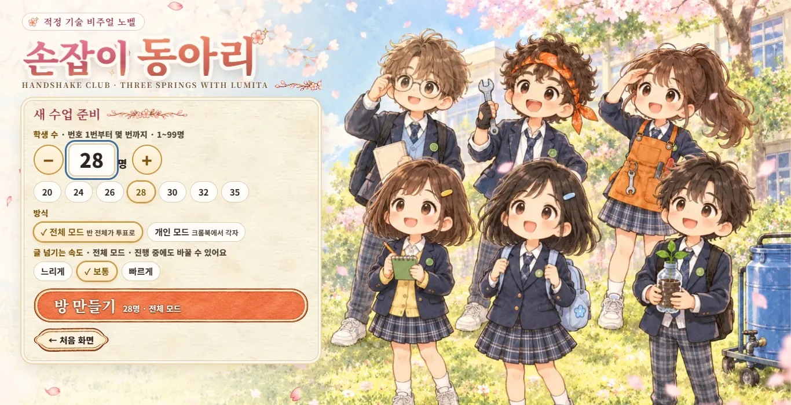
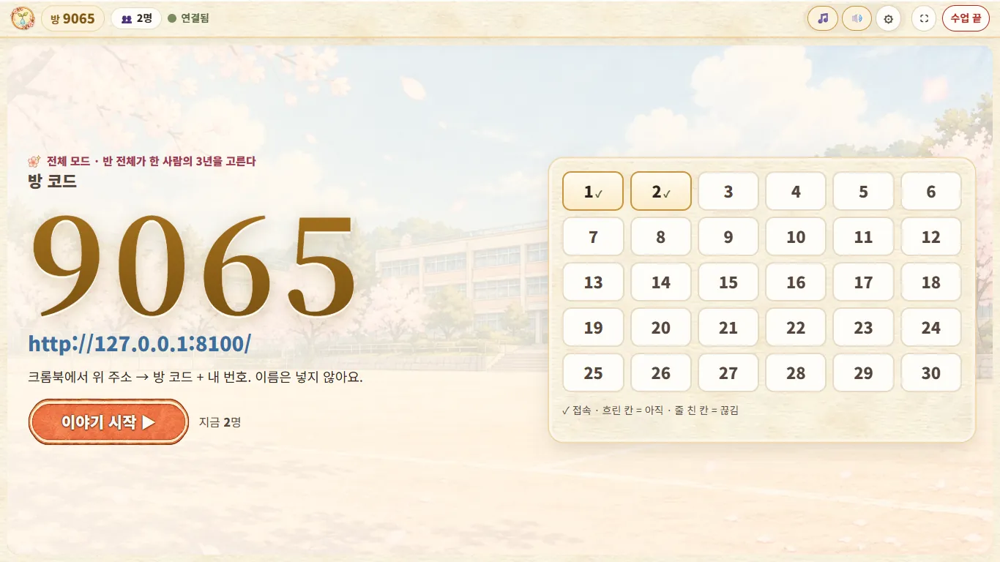
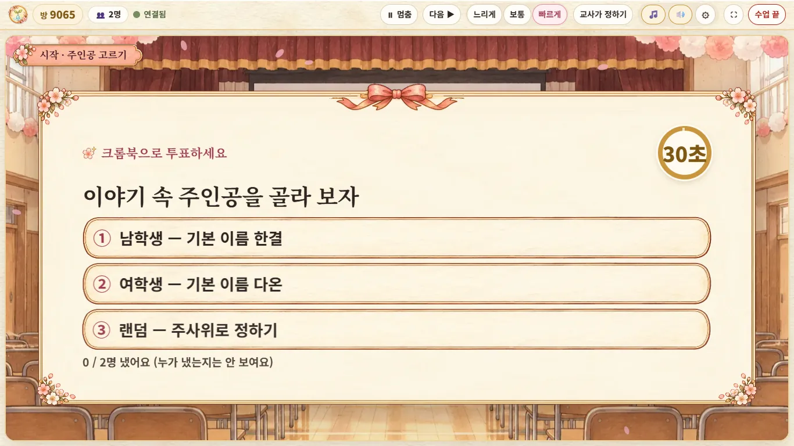
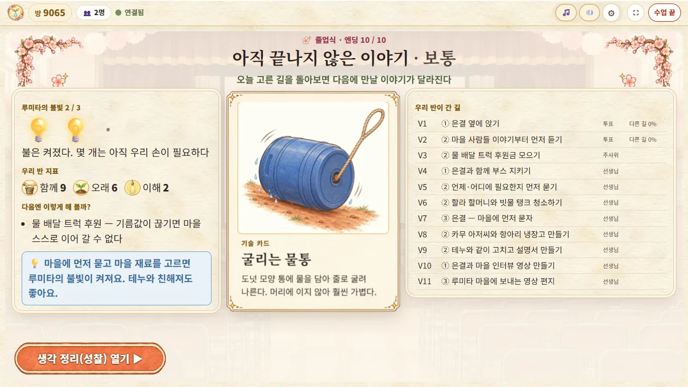
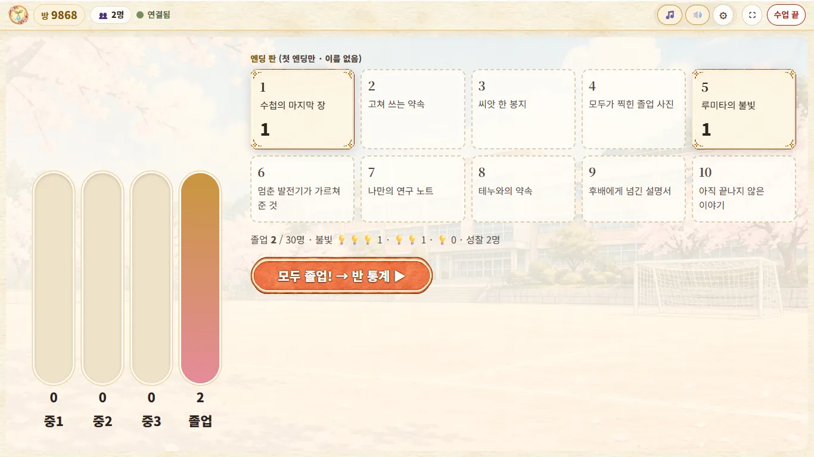
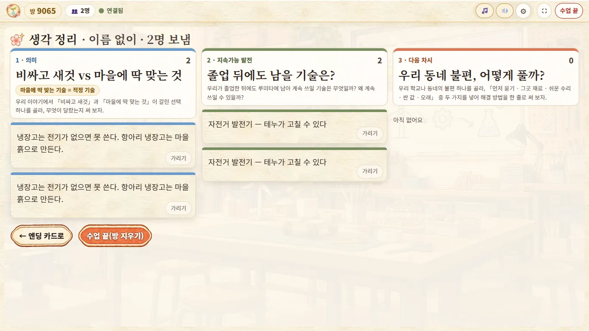
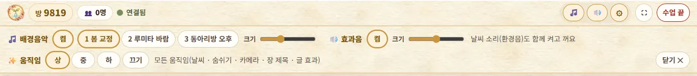

# 「손잡이 동아리」 교사용 사용법

> 적정 기술 비주얼 노벨 · 중학교 3학년 기술 `[9기가05-09]`(2015 개정) · 성적 미반영
> 학생 크롬북 **https://ict-handshake-club.netlify.app** · 교사 진행판(큰 화면) **https://ict-handshake-club.netlify.app/host.html**

이 문서는 진행판(교사 화면)과 학생 크롬북의 실제 단추 이름을 그대로 적었습니다. 학생에게는 [학생용 사용법](학생용_사용법.md)을 나눠 주시면 됩니다.

## 차례

1. [한눈에 보기](#1-한눈에-보기)
2. [수업 전 준비](#2-수업-전-준비)
3. [방 만들기](#3-방-만들기)
4. [대기실 — 방 코드 알려 주기와 자리 확인](#4-대기실--방-코드-알려-주기와-자리-확인)
5. [전체 모드 진행](#5-전체-모드-진행)
6. [비상 모드(인터넷 없이)](#6-비상-모드인터넷-없이)
7. [이어서 하기(진행판을 새로 고쳤을 때)](#7-이어서-하기진행판을-새로-고쳤을-때)
8. [개인 모드 진행](#8-개인-모드-진행)
9. [성찰 벽과 「가리기」](#9-성찰-벽과-가리기)
10. [수업 끝 — 방과 기록 지우기](#10-수업-끝--방과-기록-지우기)
11. [⚙ 소리 · 움직임 설정](#11--소리--움직임-설정)
12. [45분 수업 예시](#12-45분-수업-예시)
13. [엔딩 뒤 이야기 나누기](#13-엔딩-뒤-이야기-나누기)
14. [성취기준 연결](#14-성취기준-연결)
15. [개인정보와 데이터](#15-개인정보와-데이터)
16. [문제가 생겼을 때](#16-문제가-생겼을-때)
17. [자주 묻는 질문](#17-자주-묻는-질문)
18. [다른 학교에서 쓰려면](#18-다른-학교에서-쓰려면)

---

## 1. 한눈에 보기

| 항목 | 내용 |
|---|---|
| 이야기 | 우리 학교 「손잡이 동아리」가 가상의 나라 「카렌도」의 「루미타 마을」과 중1~중3 3년 동안 물 · 빛 · 음식 문제를 함께 풉니다. 마지막 장면은 늘 졸업식입니다 |
| 갈림길 | 12번(주인공 고르기 V0 + 이야기 V1~V11) |
| 엔딩 | 10개(연애 3 · 함께 1 · 프로젝트 대성공 1 · 실패에서 배움 1 · 혼자 연구 1 · 마을 친구 1 · 바통 1 · 보통 1) |
| 방식 | **전체 모드**: 이야기는 큰 화면, 학생은 크롬북으로 투표 / **개인 모드**: 학생이 크롬북에서 각자 끝까지 |
| 시간 | 전체 모드 한 판 약 30분(모두 빨리 내면 약 26분, 동률이 잦으면 32~35분) · 개인 모드 한 판 약 22~25분 |
| 학생 정보 | **이름을 받지 않습니다.** 방 코드 4자리 + 번호(1~99)만 씁니다 |
| 기록 | 진행판의 「수업 끝」을 누르면 방과 학생 기록(투표 · 진행 · 성찰)을 모두 지웁니다 |

## 2. 수업 전 준비

### 교사 PC · 프로젝터

- 교사 PC 브라우저(크롬 권장)에서 **진행판 주소**를 엽니다. 처음에 시작 그림(스플래시)이 나오고, 2.6초 뒤 저절로 걷히거나 누르면 바로 걷힙니다.
- 프로젝터 화면은 **⛶(전체 화면)** 단추로 키웁니다. 이 단추는 방을 만든 뒤 위쪽 띠에 생깁니다.
- 진행판은 16:9뿐 아니라 4:3 · 16:10 프로젝터에서도 글과 단추가 인물 얼굴을 가리지 않게 맞춰져 있습니다.

### 스피커

- 진행판은 처음부터 **배경음악(작게)과 효과음이 켜져** 있습니다. 음악과 효과음은 모두 코드로 만든 소리라 따로 내려받는 파일이 없습니다.
- 브라우저 규칙 때문에 **화면을 한 번 눌러야** 소리가 나기 시작합니다. 시작 그림을 누르거나 「새 수업 시작」을 누르면 됩니다.
- 진행판 탭을 다른 탭으로 옮기면 소리가 멈춥니다.

### 학생 크롬북

- 1인 1대가 기본입니다. 전체 모드에서는 투표만 하므로 2인 1대도 가능하지만, 번호 하나가 한 표입니다.
- 학생 주소는 클래스룸 게시물 등으로 미리 알려 두면 접속 시간이 줄어듭니다.
  - 주소 뒤에 `?code=방코드` 를 붙이면 방 코드 칸이 미리 채워집니다(예: `https://ict-handshake-club.netlify.app/?code=1234`). 방 코드는 수업마다 새로 생기므로 그날 방을 만든 뒤에 씁니다.
- 전체 모드 크롬북은 소리가 나지 않습니다. 개인 모드에서 소리를 쓰려면 **이어폰**을 준비합니다(처음에는 꺼져 있습니다).

### 미리 한 번 열어 보기

- 수업 전에 진행판을 열어 「새 수업 시작」 단추가 「연결 안 됨」이 아니라 정상으로 보이는지 확인합니다.
- 「연결 안 됨」이면 학교 망에서 Firebase가 막혔을 수 있습니다 → [16절](#16-문제가-생겼을-때). 그래도 **비상 모드**로는 수업할 수 있습니다.

## 3. 방 만들기



진행판 시작 메뉴에는 **새 수업 시작 · 이어서 하기(있을 때만) · 비상 모드 · 반 기록판**이 있습니다.

1. **새 수업 시작**을 누릅니다. 「새 수업 준비」 판이 열립니다.
2. **학생 수**를 정합니다.
   - − / 숫자 칸 / + 로 조절하거나, 빠른 단추 **20 · 24 · 26 · 28 · 30 · 32 · 35** 를 누릅니다.
   - **1~99명**까지 됩니다. 처음 값은 28명이고, 다음부터는 지난번 값을 기억합니다.
   - 학생 수는 「번호 1번부터 몇 번까지」라는 뜻입니다. 이 수보다 큰 번호로는 들어올 수 없습니다.
3. **방식**을 고릅니다 — **전체 모드**(반 전체가 투표로) 또는 **개인 모드**(크롬북에서 각자).
4. **글 넘기는 속도**를 고릅니다 — 느리게 · 보통 · 빠르게(전체 모드에만 쓰이며, 진행 중에도 바꿀 수 있습니다).
5. **방 만들기**를 누릅니다. 단추에 「28명 · 전체 모드」처럼 고른 값이 함께 보입니다.

- 처음 화면으로 돌아가려면 「← 처음 화면」을 누릅니다.
- 방 코드는 4자리 숫자로 무작위로 만들어지고, 이미 쓰는 코드와 겹치지 않게 검사합니다. 다른 선생님이 같은 사이트를 동시에 써도 서로 섞이지 않습니다.

## 4. 대기실 — 방 코드 알려 주기와 자리 확인



> 위 그림은 시험 화면이라 주소가 `127.0.0.1`, 방 코드가 시험용 `9522`로 보입니다. 실제 수업에서는 학생 주소(`https://ict-handshake-club.netlify.app/`)와 1~8로 시작하는 방 코드가 나옵니다.

- 왼쪽에 **방 코드**가 크게, 그 아래에 **학생 주소**가 나옵니다. 학생에게 「위 주소 → 방 코드 + 내 번호」를 안내합니다.
- 오른쪽 **번호 칸**은 학생 수만큼 생깁니다(31명부터 칸이 촘촘해지고, 넘치면 칸 안에서 스크롤됩니다).
  - **✓** = 접속 · **흐린 칸** = 아직 안 들어옴 · **줄 친 칸** = 들어왔다가 끊김
- 위쪽 띠의 **👥 ○명**과 「지금 ○명」은 지금 접속한 학생 수입니다.

### 같은 번호로 두 기기가 들어오면

- **나중에 들어온 기기가 남고**, 앞 기기에는 📵 「다른 기기에서 ○번으로 들어왔어요」가 뜹니다. 그 학생은 「○번으로 다시 들어가기」 또는 「번호 고치기」를 고를 수 있습니다.
- 같은 번호가 **2분 안에 계속 바뀌면**(서로 밀어내기) 더는 자동으로 내보내지 않고, 진행판에 「⚠ ○번이 두 기기예요 (K7 · H5) — 학생에게 번호를 확인해 주세요」가 뜹니다.
- 학생 크롬북 오른쪽 위의 **「기기 K7」** 같은 글자로 어느 기기인지 확인해 번호를 바로잡게 합니다.

### 시작

- 번호 칸에 ✓ 가 충분히 차면 **이야기 시작 ▶**(전체 모드) 또는 **개인 모드 시작 ▶**을 누릅니다.
- 늦게 온 학생도 방이 열려 있는 동안에는 언제든 들어올 수 있습니다. 전체 모드는 들어온 뒤 열려 있는 투표부터 참여합니다.

## 5. 전체 모드 진행

반 전체가 한 사람의 3년을 고릅니다. 이야기는 **큰 화면에만** 나오고, 학생 크롬북에는 「큰 화면을 보세요」와 투표 단추만 나옵니다.

### 흐름

```
장면 제목 카드(3.5초) → 대사가 한 줄씩 자동으로(한 줄 3.2초 + 글자당 0.16초) → 장면 끝 7초 멈춤
갈림길!(3.5초) → 💬 생각 시간 40초 → 투표 20초(V0 주인공 · V11 마지막 편지는 30초)
  → 마감 → 막대 공개 3초 → 지표 변화 3초(🤝 +2 · ♪) → 고른 길의 결과 장면 → 다음 장면
… V11 → 졸업식 엔딩 → 엔딩 카드(멈춤) → 생각 정리(성찰) 열기 ▶ → 성찰 벽 → 수업 끝
```

- 글 넘기는 속도 「느리게」는 대사 시간이 1.25배, 「빠르게」는 0.8배입니다.
- V0(주인공 고르기)은 생각 시간 없이 바로 투표합니다.



### 진행판 위쪽 띠 단추

| 단추 | 하는 일 |
|---|---|
| **⏸ 멈춤 / ▶ 자동 진행** | 멈추면 대사 · 장면 제목 · 결과 화면이 넘어가지 않고, 「다음 ▶」을 누를 때마다 한 단계씩 갑니다. 설명을 덧붙일 때 씁니다. 무대 아래에 「⏸ 멈춤 — 「다음 ▶」으로 한 줄씩」이 보입니다. 키보드 **P**로도 켜고 끕니다 |
| **다음 ▶** | 지금 줄 · 단계를 바로 넘깁니다. **생각 시간도 건너뜁니다**(바로 투표). 투표 시간과 🎲 주사위는 건너뛰지 않습니다 |
| **느리게 · 보통 · 빠르게** | 글 넘기는 속도. 진행 중에도 바꿀 수 있습니다 |
| **교사가 정하기** | 갈림길(생각 시간 · 투표 중)에서 누르면 선택지 목록이 열리고, 하나를 누르면 그 길로 바로 갑니다. 다른 때 누르면 「갈림길(생각 시간 · 투표)에서 쓸 수 있어요」 안내만 나옵니다 |
| 🎵 · 🔊 · ⚙ | 음악 켜기/끄기 · 효과음 켜기/끄기 · 설정 판([11절](#11--소리--움직임-설정)). 좁은 화면에서는 글자 없이 그림만 보입니다 |
| **⛶** | 전체 화면 |
| **수업 끝** | 방과 기록을 모두 지웁니다(되돌릴 수 없음) → [10절](#10-수업-끝--방과-기록-지우기) |

### 화면 눌러 넘기기와 키보드

| 조작 | 하는 일 |
|---|---|
| **화면 아무 데나 누르기** | 대사 · 장면 제목 · 지표 변화 화면에서 다음으로 넘깁니다. 글자가 찍히는 중이면 첫 누름은 글을 다 보여 주고, 다음 누름에 넘어갑니다. 빠르게 두 번 눌러도 한 번만 넘어갑니다 |
| **→ · 스페이스** | 「다음 ▶」과 같습니다(생각 시간 건너뛰기 포함) |
| **Enter** | 대사 · 장면 제목 · 지표 변화에서만 다음으로 넘깁니다 |
| **P** | 멈춤 / 자동 진행 바꾸기 |

- **갈림길 · 투표 · 결과 · 주사위 화면은 눌러도 넘어가지 않습니다**(투표는 시간대로 갑니다).
- 단추나 설정 판, 입력 칸에 커서가 있으면 키보드는 그 단추 몫이 됩니다(넘기지 않습니다).
- 처음 한 번 「화면을 눌러도 다음 줄로 넘어가요 (스페이스 · →)」 안내가 잠깐 뜹니다.

### 갈림길과 투표

1. 「갈림길!」 다음 **💬 생각 시간 40초** — 진행판에 질문과 선택지, 남은 초가 보입니다. 학생은 옆 친구와 이야기합니다. **바로 투표 ▶**(또는 「다음 ▶」)로 건너뛸 수 있습니다. 생각 시간은 「멈춤」으로 멈추지 않습니다.
2. **투표 20초**(V0 · V11은 30초) — 진행판에는 「크롬북으로 투표하세요」, 원형 초시계, 「○ / ○명 냈어요 (누가 냈는지는 안 보여요)」만 보입니다.
   - 학생은 시간 안에 몇 번이든 바꿀 수 있고, 마지막 선택만 셉니다.
   - **지금 접속한 번호가 모두 내면 3초 뒤 바로 마감**합니다.
   - 마감 뒤 1.2초 기다렸다가 **공개한 마감 시각 전에 낸 표만** 셉니다. 늦게 온 표는 서버가 받지 않습니다.
3. **결과** — 선택지마다 「○표 · ○%」 막대가 차오르고 이긴 길에 「✓ 이 길로」가 붙습니다(3초). 학생 크롬북에는 「우리 반은 ① ○○○」와 「내 선택」이 뜹니다.

**판정 규칙**

- **가장 많이 고른 길**로 갑니다(과반이 아니라 최다 득표). 투표하지 않은 학생은 세지 않습니다.
- **동률**이면 「동률이에요!」 → **동률인 길만 남겨 15초 다시 투표**(「동률! 동률인 길만 다시 투표」).
- 다시 해도 동률이면 **🎲 이야기 주사위**가 모두가 보는 앞에서 굴러 정합니다(약 3초, 건너뛸 수 없습니다). 아무도 내지 않았을 때도 바로 🎲입니다.
- **빠르기로 가르지 않습니다.** 먼저 낸 표가 유리하지 않습니다.
- 「교사가 정하기」로 고르면 언제든 교사 선택이 우선합니다(마감 직후에 눌러도 교사 선택이 이깁니다).
- V0에서 「랜덤」이 이기면 🎲가 남 · 여를 정합니다. 전체 모드 주인공 이름은 기본 이름(남 「한결」 · 여 「다온」)입니다.

### 지표와 ♪

- 선택 뒤 3초 동안 「🤝 함께 +2」 같은 지표 변화가 뜹니다. 화면 오른쪽 위 지표(🤝 함께 · 🌱 오래 · 💡 이해, 0~10)에 더해집니다.
- 친해진 인물 옆에 **♪** 가 뜹니다. 호감 숫자는 보이지 않습니다(경쟁 · 놀림을 줄이기 위해서).
- **⚠ 헛걸음**(비싸거나 · 묻지 않았거나 · 마을에서 못 고치는 선택)은 화면에 보이지 않고, 엔딩 카드의 「다음엔 이렇게 해 볼까?」에만 나옵니다.

### 엔딩과 엔딩 카드

- V11 뒤 졸업식 엔딩 장면이 나옵니다. 엔딩 그림은 자르지 않고 크게, 글은 옆(4:3 화면은 아래) 종이 칸에 큰 글씨로 나옵니다.
- 엔딩 장면이 끝나면 **엔딩 카드**에서 멈춥니다(자동으로 넘어가지 않습니다).



| 칸 | 내용 |
|---|---|
| 맨 위 | 「졸업식 · 엔딩 ○ / 10」 · 엔딩 이름 · 그 엔딩의 적정 기술 메시지 |
| 루미타의 불빛 | 💡 1~3개와 한 줄 풀이 · 우리 반 지표(🤝 · 🌱 · 💡 최종값) · 「다음엔 이렇게 해 볼까?」(⚠ 헛걸음이 된 선택과 까닭) |
| 기술 카드 | 이 엔딩과 이어지는 적정 기술 한 장(그림 + 설명) |
| 우리 반이 간 길 | V1~V11 각각 고른 길 · 정한 방법(투표 · 주사위 · 선생님) · **「다른 길 ○%」**(1차 투표에서 그 길을 고르지 않은 학생 비율) |

- **생각 정리(성찰) 열기 ▶** 를 누르면 학생 크롬북에 질문 칸이 열리고, 진행판은 성찰 벽으로 바뀝니다 → [9절](#9-성찰-벽과-가리기).
- 엔딩이 나오면 시작 화면의 **반 기록판**에 날짜 · 시각 · 방식 · 결과(엔딩 번호와 이름) · 불빛이 한 줄 남습니다(교사 PC에만).

**루미타의 불빛**

| 불빛 | 조건 | 한 줄 |
|---|---|---|
| 💡💡💡 | 🤝 6 이상 · 🌱 6 이상 · ⚠ 0 | 마을이 스스로 불을 켜고, 고치고, 이어 간다 |
| 💡💡 | ⚠ 1 이하 · 🤝+🌱+💡 합 10 이상 | 불은 켜졌다. 몇 개는 아직 우리 손이 필요하다 |
| 💡 | 그 밖 | 다음엔 처음부터 같이 정하자 |

**엔딩 10개**(교사 참고용 — 학생에게 미리 알려 주지 않는 편이 재미있습니다)

| # | 이름 | 엔딩 메시지 |
|---|---|---|
| E1 | 수첩의 마지막 장 | 적정 기술은 먼저 귀 기울여 듣는 데서 시작한다 |
| E2 | 고쳐 쓰는 약속 | 스스로 고쳐 쓸 수 있어야 진짜 오래가는 기술이다 |
| E3 | 씨앗 한 봉지 | 작게, 싸게, 오래 — 그래야 마을이 계속 쓸 수 있다 |
| E4 | 모두가 찍힌 졸업 사진 | 좋은 기술은 혼자가 아니라 마음을 모아 함께 만든다 |
| E5 | 루미타의 불빛 · 프로젝트 대성공 | 적정 기술의 완성은 마을이 스스로 이어 가는 것, 지속가능 발전 |
| E6 | 멈춘 발전기가 가르쳐 준 것 · 실패에서 배움 | 비싸고 새로운 것이 늘 답은 아니다. 실패를 돌아보고 고치는 것도 기술이다 |
| E7 | 나만의 연구 노트 · 혼자 연구 | 깊이 아는 힘은 소중하다. 그 앎을 사람들과 나눌 때 진짜 기술이 된다 |
| E8 | 테누와의 약속 · 마을 친구 | 주는 사람과 받는 사람이 아니라 함께 고민하고 배우는 동료 |
| E9 | 후배에게 넘긴 설명서 · 바통 | 사람이 바뀌어도 누구나 보고 이어 갈 수 있어야 지속 가능하다 |
| E10 | 아직 끝나지 않은 이야기 · 보통 | 오늘 고른 길을 돌아보면 다음에 만날 이야기가 달라진다(엔딩 카드에 다른 엔딩으로 가는 힌트 한 줄) |

- E1~E3 연애 엔딩은 **설렘 · 고백까지**만 그립니다. 남 · 여 주인공의 엔딩은 같은 번호로 셉니다(상대 인물과 그림만 다름).
- 엔딩 판정 조건은 [기획서](기획서.md) 7절에 있습니다.

## 6. 비상 모드(인터넷 없이)

학교 망이 막혔거나 Firebase에 연결되지 않을 때 씁니다.

1. 시작 메뉴의 **비상 모드**를 누릅니다.
2. 「비상 모드(인터넷 없이)로 시작할까요? 학생 투표는 받지 않고, 교사가 손 든 수를 보고 갈림길을 고릅니다.」 → 확인.
3. 대기실 없이 바로 이야기가 시작됩니다(항상 전체 모드). 위쪽 띠에 「비상 모드(인터넷 없이)」가 보입니다.
4. 갈림길에서는 생각 시간 40초(「바로 투표 ▶」로 건너뛰기 가능) 뒤 「손을 들어 고르고, 선생님이 눌러요」 화면이 나옵니다. 손을 든 수를 세어 그 선택지의 **이 길로** 단추를 누릅니다.

- 이야기 · 효과 · 엔딩은 보통 전체 모드와 같습니다. 학생 크롬북은 쓰지 않습니다.
- 학생 답이 모이지 않으므로 성찰 벽은 비어 있습니다. 성찰 질문은 종이나 말로 나눕니다.
- 엔딩 카드의 「다른 길 ○%」는 투표가 없어 비어 있습니다.

## 7. 이어서 하기(진행판을 새로 고쳤을 때)

- 진행 중에 진행판 창을 닫거나 새로 고치려 하면 브라우저가 「사이트에서 나가시겠습니까?」를 묻습니다. 실수라면 취소합니다.
- 이미 새로 고쳤다면 시작 메뉴에 **이어서 하기**(「28명 · 방 1234」처럼 표시)가 생깁니다. 마지막 저장 뒤 **8시간 안**에만 보입니다.
- 누르면 **그 장면의 그 줄부터** 다시 이어 갑니다. 투표 중이었다면 그 갈림길 투표를 **새로 다시** 엽니다(학생은 다시 냅니다). 엔딩 카드 · 성찰 벽에 있었다면 그 화면으로 돌아갑니다.
- 학생 크롬북은 그대로 방에 남아 있으므로 다시 들어올 필요가 없습니다.
- 같은 교사 PC · 같은 브라우저에서만 됩니다(방 주인 정보가 그 브라우저에 있습니다).

## 8. 개인 모드 진행

학생이 크롬북에서 각자 끝까지 합니다. 진행판에는 진행 상황과 엔딩 통계만 나옵니다. 이름 · 번호는 나오지 않습니다.

1. 대기실에서 **개인 모드 시작 ▶** → 학생 크롬북이 열립니다.
2. 학생은 주인공(남학생 · 여학생 · 🎲 랜덤) → 이름(보기 4개 중 하나, 첫째가 기본) → 이야기 순서로 갑니다.
3. 학생은 화면 아무 데나 누르거나 「다음 ▶」 · 스페이스 · Enter · → 로 글을 넘기고, 갈림길에서는 단추로 직접 고릅니다(한 번 고르면 되돌릴 수 없습니다).
4. 졸업한 학생은 엔딩 카드 → **생각 정리**(첫 졸업 때 반드시 한 칸 이상) → **엔딩 도감(○/10) + 우리 반 첫 엔딩 통계** → 원하면 **다른 졸업식 찾기 ▶**(2회차 · 읽은 장면은 「⏩ 읽은 장면 넘기기」).



| 진행판 칸 | 내용 |
|---|---|
| 왼쪽 막대 | 지금 **중1 · 중2 · 중3 · 졸업**에 있는 학생 수 |
| 엔딩 판 | 10칸. 첫 엔딩이 들어올 때마다 칸이 차고 숫자가 오릅니다(첫 엔딩만 · 이름 없음) |
| 아랫줄 | 졸업 ○ / ○명 · 불빛 💡💡💡 · 💡💡 · 💡 별 학생 수 · 성찰 ○명 |

- **반 통계에는 학생마다 처음 본 엔딩만** 들어갑니다. 2회차 결과는 들어가지 않습니다.
- 학생이 크롬북을 새로 고쳐도 그 자리에서 이어 갑니다. 다른 크롬북으로 바꾸면 처음부터입니다(진행판은 번호마다 가장 많이 간 기록 하나로 셉니다).
- 개인 모드 진행판에는 멈춤 · 속도 · 교사가 정하기 단추가 없습니다.

### 마무리

1. **모두 졸업! → 반 통계 ▶** 을 누릅니다.
   - 아직 못 끝낸 학생 화면은 「선생님 화면을 보세요」로 바뀌고, 더는 진행 기록이 들어오지 않습니다.
   - 끝낸 학생은 도감과 반 통계를 보며 「선생님 화면을 보세요 — 반 통계를 함께 봐요」가 뜹니다.
2. 반 통계 화면 — **우리 반 첫 엔딩**(10칸 막대) · 루미타의 불빛별 학생 수 · **갈림길마다 가장 많이 고른 길과 비율**(성별이 드러나지 않는 이름으로 표시).
   - 시간이 남아 더 하게 하고 싶으면 **← 진행 화면**을 눌러 다시 엽니다.
3. **성찰 모아 보기 (○) ▶** → 성찰 벽 → **수업 끝**.

## 9. 성찰 벽과 「가리기」



- 질문 3개가 칸 하나씩 나란히 나오고, 학생 답이 **이름 없이** 카드로 모입니다. 같은 질문 안에서는 순서를 섞어 누가 썼는지 알 수 없게 합니다.
- 맨 위에 「이름 없이 · ○명 보냄」, 칸마다 답 수가 보입니다.
- 학생은 보낸 뒤에도 「고쳐 쓰기」로 고칠 수 있고, 고친 답이 바로 바뀝니다.

| 질문 | 큰 화면 제목 | 자세한 질문 |
|---|---|---|
| 1 · 의미 | 비싸고 새것 vs 마을에 딱 맞는 것 (부제: 마을에 딱 맞는 기술 = 적정 기술) | 우리 이야기에서 「비싸고 새것」과 「마을에 딱 맞는 것」이 갈린 선택 하나를 골라, 무엇이 달랐는지 써 보자 |
| 2 · 지속가능 발전 | 졸업 뒤에도 남을 기술은? | 우리가 졸업한 뒤에도 루미타에 남아 계속 쓰일 기술은 무엇일까? 왜 계속 쓰일 수 있을까? |
| 3 · 다음 차시 | 우리 동네 불편, 어떻게 풀까? | 우리 학교나 동네의 불편 하나를 골라, 「먼저 묻기 · 그곳 재료 · 쉬운 수리 · 싼 값 · 오래」 중 두 가지를 넣어 해결 방법을 한 줄로 써 보자 |

**가리기**

- 부적절한 답은 카드 오른쪽 아래 **가리기**를 누릅니다 → 「이 성찰을 가릴까요? (데이터에서도 지워요)」 → 확인.
- **그 학생이 보낸 답 전체(세 칸 모두)** 가 벽에서 사라지고 데이터에서도 지워집니다.
- 화면 아래 **← 엔딩 카드로**(전체 모드) / **← 반 통계로**(개인 모드)로 돌아갈 수 있습니다.

## 10. 수업 끝 — 방과 기록 지우기

- 위쪽 띠의 **수업 끝** 또는 성찰 벽 아래 **수업 끝(방 지우기)** 를 누릅니다.
- 「수업을 끝낼까요? 방과 학생 기록(투표 · 진행 · 성찰)을 모두 지웁니다.」 → 확인하면 방을 통째로 지우고 시작 화면으로 돌아갑니다. **되돌릴 수 없습니다.**
- 학생 크롬북에는 「수업이 끝났어요. 수고했어요!」가 뜹니다.
- 인터넷이 끊겨 지우지 못하면 「방을 지우지 못했어요. 인터넷을 확인하고 다시 눌러 주세요」가 뜹니다. 연결을 확인하고 다시 누릅니다.
- 깜빡하고 끄지 못한 방은, 같은 교사 PC에서 다음에 진행판을 열 때 **하루가 지난 방부터 저절로 지웁니다.**
- 개인 모드는 수업 끝을 누를 때 「○명 졸업 · 가장 많은 엔딩 E○」가 반 기록판에 남습니다.

### 반 기록판

- 시작 메뉴의 **반 기록판**을 누르면 지난 수업 결과가 최근 12개까지 보입니다(최대 60개 저장).
- 칸: 날짜 · 시각 · 방식(전체 · 개인) · 결과 · 불빛. **이 컴퓨터에만** 있고 이름 · 번호 · 반 이름은 없습니다. 몇 반이었는지는 날짜 · 시각으로 구분합니다.

## 11. ⚙ 소리 · 움직임 설정



- 위쪽 띠의 🎵(음악) · 🔊(효과음)은 누를 때마다 바로 켜고 끕니다. 꺼진 단추에는 ✕ 가 붙습니다. 시작 화면에서는 이 단추가 아래쪽 띠에 있습니다.
- **⚙ 설정**을 누르면 띠 바로 아래에 설정 줄이 열립니다(화면을 아래로 밀어 내려 그림을 덮지 않습니다). **닫기 ✕** 또는 **Esc** 로 닫습니다.

| 줄 | 고를 것 |
|---|---|
| 🎵 배경음악 | 켬/끔 · 이야기 곡 **1 「봄 교정」**(오르골) · **2 「루미타 바람」**(마림바 · 기타) · **3 「동아리방 오후」**(전자 피아노) · 크기 |
| 🔊 효과음 | 켬/끔 · 크기. 날씨 소리(비 · 밤 · 바람 · 방 안)도 함께 켜지고 꺼집니다 |
| ✨ 움직임 | **상 · 중 · 하 · 끄기** |

**음악은 장면에 따라 저절로 바뀝니다**

| 때 | 곡 |
|---|---|
| 시작 화면 · 수업 설정 · 대기실 | 여는 곡 「여는 이야기」 |
| 이야기 동안 | 설정에서 고른 곡 하나(1 · 2 · 3). 바꾸면 바로 스르륵 바뀝니다. 밤 장면은 더 작고 부드럽게, 문제가 터진 장면은 조금 어둡게 |
| 엔딩 장면 · 엔딩 카드 · 성찰 | 엔딩 곡 「졸업 편지」 |

**처음 값(화면마다 다름)**

| 화면 | 움직임 | 소리 |
|---|---|---|
| 진행판(큰 화면) | **상** | 음악 켬(작게) · 효과음 켬. 화면을 한 번 눌러야 소리가 납니다 |
| 전체 모드 크롬북 | **하** | **항상 소리 없음**(소리 단추가 없고, ⚙ 에는 움직임만) |
| 개인 모드 크롬북 | **하** | 처음엔 꺼짐. 학생이 🎵 · 🔊 · ⚙ 로 켭니다 |

- 컴퓨터 설정의 「움직임 줄이기」가 켜져 있으면 처음 움직임이 **끄기**입니다.
- 설정은 그 컴퓨터(그 브라우저)에 기억됩니다.

| 움직임 | 화면 |
|---|---|
| 상 | 날씨 알갱이(비 · 눈 · 반딧불 · 별 · 꽃잎 · 먼지 빛 등, 최대 약 120개) · 말하는 인물 강조 · 숨쉬기 · 배경 천천히 밀기 · 장 제목 · 글자 강조 · 기술 성공 빛과 카메라 밀기 · 투표 연출 · 엔딩 꽃가루 |
| 중 | 알갱이 절반(최대 약 50개) · 숨쉬기만 · 흔들림 · 카메라 밀기 없음 |
| 하 | 나타나기 · 밀려오기만(알갱이 · 숨쉬기 · 배경 밀기 없음) |
| 끄기 | 움직임 없음. 화면이 바로 바뀌고 글자 찍기 · 흔들림 · 꽃가루도 없습니다 |

> 어떤 효과도 인물 얼굴을 덮지 않게 만들었습니다. 날씨 알갱이는 인물 뒤에 그리고 머리 둘레는 비워 둡니다.

## 12. 45분 수업 예시

[기획서](기획서.md) 2절의 시간표를 실제 진행 시간에 맞춰 적었습니다.

**전체 모드**

| 분 | 활동 |
|---|---|
| 0~3 | 진행판 방 만들기 · 학생 접속(방 코드 + 번호) · 「오늘은 반 전체가 한 사람의 3년을 고른다」 |
| 3~5 | 프롤로그(졸업식 아침) · 주인공 투표(V0) |
| 5~33 | 본편: 중1(갈림길 4) → 중2(3) → 중3(4). 갈림길 하나에 약 2.5분 |
| 33~36 | 졸업식 엔딩 · 엔딩 카드(루미타의 불빛 · 기술 카드 · 「다른 길 ○%」) |
| 36~45 | 성찰 열기 · 성찰 벽 · 이야기 나누기([13절](#13-엔딩-뒤-이야기-나누기)) · 수업 끝 |

- 시간이 빠듯하면 「바로 투표 ▶」로 생각 시간을 줄이거나, 글 속도를 「빠르게」로 바꾸거나, 「교사가 정하기」를 씁니다.

**개인 모드**

| 분 | 활동 |
|---|---|
| 0~4 | 접속 · 조작 안내(화면 누르기로 넘김 · 갈림길은 되돌릴 수 없음 · 소리는 이어폰) |
| 4~30 | 각자 플레이(한 판 약 22~25분). 일찍 끝난 학생은 「다른 졸업식 찾기」 |
| 30~35 | 「모두 졸업!」 → 반 통계 · 갈림길별 가장 많이 고른 길 |
| 35~45 | 성찰 모아 보기 · 이야기 나누기 · 수업 끝 |

- 성취기준 수업 계획상 **12월 1~2주 첫 시간**(적정 기술의 의미 도입)에 쓰고, 다음 시간 국내외 사례 조사로 잇는 것을 권장합니다.

## 13. 엔딩 뒤 이야기 나누기

아래는 [기획서](기획서.md) 9절의 정리 활동을 바탕으로 한 **제안**입니다. 게임 기능이 아니라 수업 아이디어입니다.

**엔딩 카드 · 반 통계를 보며 묻기**

- 「다른 길 ○%」가 가장 컸던 갈림길은 어디였나요? 그 길을 고른 사람은 무엇을 생각했을까요?
- 우리 반의 불빛은 몇 개였나요? 💡💡💡 이 되려면 어느 갈림길에서 무엇이 달라야 했을까요?
- 「다음엔 이렇게 해 볼까?」에 나온 선택은 왜 헛걸음이 됐을까요? 비싸고 새로운 기술이 마을에서 안 맞은 까닭은?
- 연애 · 우정 엔딩을 봤어도 프로젝트 결과(불빛)는 따로 나옵니다. 두 결과가 다를 때 무엇을 알 수 있나요?
- (개인 모드) 우리 반에서 가장 많이 나온 엔딩과 한 명도 없는 엔딩은? 그 엔딩에는 어떻게 가야 할까요?

**기술 카드 → 실제 사례 잇기(2분)**

게임 안에는 상표 · 실제 단체 이름이 없습니다. 실제 이름은 정리 슬라이드에서 알려 줍니다.

| 게임 속 이름 | 실제 사례 | 무엇을 · 어떻게 |
|---|---|---|
| 굴리는 물통 | Q드럼 | 도넛 모양 통에 물을 담아 줄로 굴려 나른다 |
| 정수 빨대 | 라이프스트로 | 빨대 속 거름 장치가 세균 · 기생충을 걸러 낸다(바닷물 · 화학 물질은 못 거른다) |
| 빗물 모으기 | 빗물 저장 | 지붕 → 홈통 → 뚜껑 있는 탱크. 처음 빗물은 먼지가 많아 버린다 |
| 페트병 전구 | 리터 오브 라이트 | 물을 넣은 페트병을 지붕에 끼우면 햇빛이 방 안으로 퍼진다. 낮에만 |
| 자전거 발전기 | 자전거 발전기 | 페달을 돌려 전기를 만들어 LED · 휴대 전화를 켠다 |
| 태양열 조리기 | 태양열 조리기 | 반사판으로 햇빛을 모아 요리한다. 흐린 날은 어렵다 |
| 항아리 냉장고 | 팟인팟(항아리 냉장고) | 두 항아리 사이 젖은 모래의 물이 마르며 열을 빼앗는다. 덥고 건조할 때 잘 된다 |

**성찰 질문 3번 → 다음 차시**

- 「우리 동네 불편」 답을 모아 12월 3~4주 적정 기술 체험 활동의 주제 후보로 씁니다.

## 14. 성취기준 연결

> **[9기가05-09]** 적정기술과 지속가능 발전의 의미를 이해하고, 적정기술 체험 활동을 통하여 문제를 창의적으로 탐색하고 실현하고 평가한다. (2015 개정 교육과정)

| 성취기준 요소 | 게임 속 자리 |
|---|---|
| 적정 기술의 **의미** | 중1 첫 화상 통화(V2) · 물 나르기(V3) · 모든 기술 카드 — 「그 지역 사람이 쉽게 만들고 · 쓰고 · 고칠 수 있는 기술」 |
| 지속가능 발전의 **의미** | 중3 고장 사건(V9) · 후배에게 넘기기(V10) · 대성공 엔딩(E5) · 바통 엔딩(E9) |
| 문제를 창의적으로 **탐색** | 갈림길마다 2~4개의 선택지 — 좋은 답이 하나가 아닌 갈림길이 많습니다 |
| **실현** | 선택 뒤 결과 장면(마을이 실제로 쓰는 모습). 실물 체험은 12월 3~4주 활동이 맡습니다 |
| **평가** | 루미타의 불빛 · 「다음엔 이렇게 해 볼까?」 · 성찰 질문 |

- 지표의 뜻: 🤝 **함께**(마을 사람 참여) · 🌱 **오래**(마을 재료 · 싼 값 · 마을에서 고칠 수 있음 = 지속 가능성) · 💡 **이해**(원리 이해) · ⚠ **헛걸음**(비싸거나 묻지 않았거나 마을에서 못 고치는 선택).
- 이 게임은 **성적에 반영하지 않습니다.** 정의적 능력 관찰에 참고할 수는 있지만 점수는 매기지 않는 것을 전제로 만들었습니다.

## 15. 개인정보와 데이터

**받지 않는 것**: 학생 이름 · 학번 · 이메일 · 계정. 학생은 익명 로그인(Firebase 익명 인증)으로 들어오고, 화면에 입력하는 것은 방 코드와 번호뿐입니다. 주인공 성별 · 이름은 서버로 보내지 않으며, 보안 규칙으로도 그런 칸을 만들 수 없게 막아 두었습니다.

| 어디에 | 무엇이 | 언제 지워지나 |
|---|---|---|
| 서버(Firebase 실시간 DB · `/vn/rooms/방코드`) | 방 정보(만든 시각 · 학생 수 · 방식 · 단계) · 진행판 상태 · 학생 자리(번호 · 접속 여부 · 시각) · 전체 모드 투표(선택 번호 · 시각) · 개인 모드 진행(단계 · 선택 번호 · 엔딩 번호 · 불빛 수 — 숫자만) · 성찰 글(한 칸 200자까지) | **수업 끝**을 누를 때 방 전체를 지웁니다. 「가리기」한 성찰은 그 즉시. 끄지 못한 방은 같은 교사 PC에서 다음에 진행판을 열 때 하루 지난 것부터 지웁니다 |
| 학생 크롬북(브라우저 저장소) | 들어간 방 코드 · 번호(6시간 동안 자동 재접속용) · 개인 모드 진행과 주인공 성별 · 이름 · 엔딩 도감 · 내가 쓴 성찰 사본 · 소리 · 움직임 설정 | 방 코드 · 번호는 수업이 끝날 때 학생 화면이 열려 있으면 지우고, 6시간이 지나면 다시 쓰지 않습니다. 나머지는 그 크롬북에만 남고 서버로 가지 않습니다(브라우저 기록을 지우면 사라집니다) |
| 교사 PC(브라우저 저장소) | 수업 설정(학생 수 · 방식 · 속도) · 이어서 하기용 진행 상태(8시간) · 만든 방 목록 · 반 기록판(날짜 · 방식 · 결과 · 불빛, 최대 60개) · 소리 · 움직임 설정 | 진행 상태는 수업 끝에 지웁니다. 반 기록판은 그 PC에만 남습니다 |

- 진행판에는 누가 무엇에 투표했는지 보이지 않습니다(「○ / ○명 냈어요」만). 성찰 벽에도 이름 · 번호가 없습니다.
- 개인 모드 반 통계에는 성별이 드러나지 않는 이름(「듣는 친구」 등)으로 갈림길을 표시합니다.
- 화면의 「기기 K7」 같은 글자는 기기를 구분하는 무작위 표시일 뿐 개인정보가 아닙니다.
- 무료 요금제(Spark)를 씁니다. 동시 연결은 프로젝트 전체에서 100개까지입니다(같은 Firebase 프로젝트를 쓰는 다른 수업 사이트와 합산 · 약 세 반이 한꺼번에).

## 16. 문제가 생겼을 때

| 증상 | 확인 · 해결 |
|---|---|
| 진행판에 「인터넷(데이터베이스)에 연결하지 못했어요」 · 단추가 「연결 안 됨」 | 학교 망이나 필터가 Google · Firebase 주소를 막았을 수 있습니다. 쓰는 주소: 사이트 `ict-handshake-club.netlify.app` · 실시간 DB `*.asia-southeast1.firebasedatabase.app`(웹소켓 포함) · 익명 로그인 `identitytoolkit.googleapis.com` · `securetoken.googleapis.com`. 정보 담당 선생님께 허용을 요청하고, 당장은 **비상 모드**로 진행합니다 |
| 학생이 「연결이 안 돼요. 와이파이를 확인하고 다시 눌러 주세요」 | 크롬북 와이파이 확인 → 「들어가기」 다시. 교사 PC는 되는데 크롬북만 안 되면 학생망 필터를 확인합니다 |
| 학생이 「그런 방이 없어요」 | 방 코드 오타이거나, 이미 「수업 끝」을 누른 방입니다 |
| 학생이 「우리 반 번호는 1~○번이에요」 | 방을 만들 때 학생 수를 실제보다 적게 잡았습니다. 학생 수를 바꿀 수는 없으므로, 그 학생에게 빈 번호를 쓰게 하거나 방을 새로 만듭니다 |
| 학생이 📵 「다른 기기에서 ○번으로 들어왔어요」 | 다른 크롬북이 같은 번호로 들어왔습니다. [4절](#같은-번호로-두-기기가-들어오면)처럼 「기기 ○○」 글자로 확인해 번호를 바로잡습니다 |
| 투표 수가 접속 수보다 적은데 마감이 안 됨 | 「모두 냈다」는 지금 **접속 중인** 번호 기준입니다. 끊긴 크롬북이 있으면 시간대로 마감합니다. 급하면 「교사가 정하기」 |
| 소리가 안 남(진행판) | ① 화면을 한 번 누릅니다(브라우저 자동 재생 규칙) ② 위쪽 띠 🎵 · 🔊 에 ✕ 가 있으면 눌러 켭니다 ③ ⚙ 의 크기 막대 ④ PC · 스피커 음량 ⑤ 진행판 탭이 앞에 있는지(다른 탭으로 옮기면 멈춤) |
| 소리가 안 남(크롬북) | 전체 모드 크롬북은 원래 소리가 없습니다. 개인 모드는 처음에 꺼져 있으니 🎵 · 🔊 를 켜게 합니다 |
| 크롬북이 느리거나 화면이 끊김 | ⚙ 설정 → 움직임 **「하」** 또는 **「끄기」**(크롬북은 처음부터 「하」입니다). 진행판도 PC가 느리면 「중」이나 「하」로 내립니다 |
| 크롬북이 어두운 화면(다크 모드) | 이 사이트는 늘 밝은 화면으로 보이도록 지정해 두었습니다. 그래도 색이 뒤집혀 보이면 크롬 실험 기능(`chrome://flags` 의 웹 콘텐츠 자동 다크 모드)이나 확장 프로그램이 켜져 있는지 확인합니다 |
| 움직임 때문에 어지럽다는 학생 | 그 학생 크롬북에서 ⚙ → 움직임 **「끄기」** |
| 진행판을 새로 고쳤음 | 시작 메뉴 **이어서 하기**([7절](#7-이어서-하기진행판을-새로-고쳤을-때)) |
| 「방을 지우지 못했어요」 | 인터넷 연결을 확인하고 「수업 끝」을 다시 누릅니다. 그래도 안 되면 같은 PC에서 하루 뒤 진행판을 열 때 저절로 지웁니다 |
| 4:3 프로젝터에서 수업 설정 판이 잘림 | 판 안에서 스크롤하면 아래 단추가 보입니다 |

## 17. 자주 묻는 질문

**Q. 학생 이름을 꼭 안 받아도 되나요? 누가 참여했는지 알고 싶어요.**
A. 이름은 받지 않습니다. 대기실 번호 칸의 ✓ 로 몇 번이 들어왔는지만 볼 수 있습니다. 누가 무엇에 투표했는지는 교사도 볼 수 없게 만들었습니다.

**Q. 한 반에 30명이 넘어요.**
A. 학생 수는 1~99명까지 정할 수 있습니다.

**Q. 방을 만든 뒤 학생 수나 모드를 바꿀 수 있나요?**
A. 바꿀 수 없습니다. 「수업 끝」으로 방을 지우고 새로 만듭니다.

**Q. 전체 모드에서 투표가 반으로 갈리면 어떻게 되나요?**
A. 동률인 길만 남겨 15초 다시 투표하고, 또 동률이면 🎲 주사위가 정합니다. 먼저 낸 표가 유리하지 않습니다.

**Q. 시간이 모자라요.**
A. 생각 시간은 「바로 투표 ▶」나 →로 건너뛸 수 있고, 글 속도를 「빠르게」로 바꿀 수 있습니다. 갈림길마다 「교사가 정하기」로 바로 고를 수도 있습니다.

**Q. 멈춤을 누르면 투표 시간도 멈추나요?**
A. 아니요. 멈춤은 대사 · 장면 제목 · 결과 · 지표 화면에만 걸립니다. 생각 시간 · 투표 · 주사위는 시간대로 갑니다.

**Q. 개인 모드에서 한 학생이 여러 번 하면 통계가 늘어나나요?**
A. 아니요. 반 통계에는 학생마다 처음 본 엔딩 하나만 들어갑니다.

**Q. 연애 엔딩이 수업에 괜찮을까요?**
A. 연애는 설렘과 고백까지만 그리고, 몸 접촉 · 외모 평가 · 질투 장면은 없습니다. 우정 · 프로젝트 엔딩과 같은 무게로 다루고, 어떤 엔딩이든 프로젝트 결과(루미타의 불빛)는 따로 보입니다.

**Q. 루미타 마을은 실제 있는 곳인가요?**
A. 아닙니다. 「카렌도」와 「루미타」는 지어낸 이름입니다. 마을 사람들은 「도움을 받는 사람」이 아니라 솜씨 있는 동료로 그렸습니다.

**Q. 인터넷이 아예 안 돼요.**
A. 시작 메뉴의 **비상 모드**로 학생 손들기 + 교사 선택으로 진행합니다. 이야기와 엔딩은 같습니다.

**Q. 다른 선생님이 같은 시간에 써도 되나요?**
A. 됩니다. 방 코드가 달라 서로 섞이지 않습니다. 다만 무료 요금제의 동시 연결 한도(약 세 반)가 있습니다.

## 18. 다른 학교에서 쓰려면

이 배포 주소는 호원중 수업용 Firebase 프로젝트에 연결되어 있고, 웹 키가 이 배포 주소에서만 쓰이도록 제한되어 있습니다. 다른 학교에서는 **자기 Firebase 프로젝트로 사본을 띄워야** 합니다.

방법은 저장소 [README의 「내 학교에서 쓰려면」](../README.md#내-학교에서-쓰려면)에 단계별로 적어 두었습니다(Firebase 프로젝트 만들기 → 웹 설정값 바꾸기 → 보안 규칙 게시 → 빌드 · 정적 호스팅 → API 키 웹사이트 제한).
