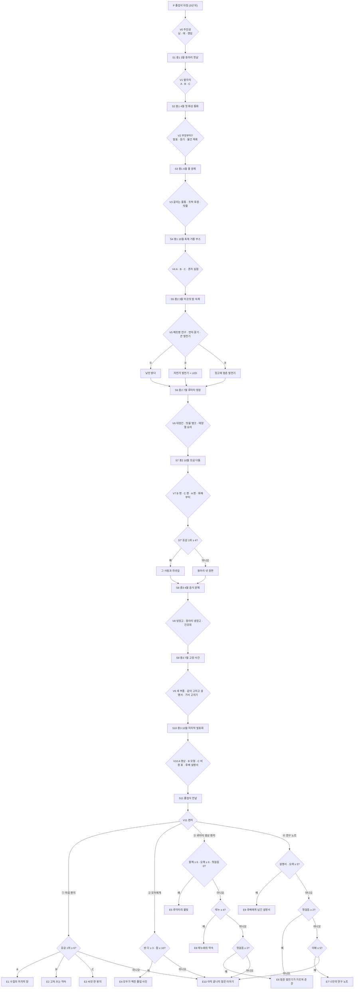

# 「손잡이 동아리」 — 적정 기술 미연시 기획서 (교사 검토용 · 2026-10-29)

> **상태: 기획만. 게임은 아직 만들지 않았다.** 교사가 12절 「정할 것」에 답하면 제작에 들어간다.
> 대상: 호원중학교 3학년 기술(2015 개정) · 2026학년도 2학기 12월~1월 「적정 기술」 · 성적 미반영.

---

## 1. 한 줄 소개 · 수업 목표 · 성취기준 연결

### 한 줄 소개

**중학교 1학년부터 3학년까지, 우리 학교 「손잡이 동아리」가 먼 나라 루미타 마을과 함께 물 · 빛 · 음식 문제를 풀어 가는 3년 이야기. 마지막 장면은 언제나 졸업식이다 — 「나는 어떤 졸업식을 맞이할까?」**

- 동화체 · SD 그림의 비주얼 노벨(미연시 형식). 선택 12번(주인공 고르기 1 + 이야기 11), 엔딩 10개
- 축이 둘이다
  - **프로젝트 축(주)**: 마을에 묻고, 마을 재료로, 마을 사람이 고칠 수 있게, 싸고 오래 가게 고를수록 마을이 밝아진다
  - **관계 축(부)**: 동아리 친구와의 우정 · 설렘(고백까지) · 마을 친구와의 우정
- 두 가지 방식: **개인 모드**(크롬북 1인 1대로 각자 끝까지) / **전체 모드**(반 전체가 모든 갈림길을 투표)

### 수업 목표 (학생 말로)

1. 적정 기술이 무엇인지, 「비싸고 새로운 기술」과 어떻게 다른지 말할 수 있다
2. 적정 기술 사례(굴리는 물통 · 정수 빨대 · 항아리 냉장고 · 페트병 전구 · 태양열 조리기 · 빗물 저장 · 자전거 발전기)가 어떤 문제를 어떤 원리로 푸는지 말할 수 있다
3. 「그 마을 사람들이 계속 쓸 수 있는가」로 기술을 평가하고, 이것이 지속가능 발전과 어떻게 이어지는지 설명할 수 있다

### 성취기준 (원문)

최종 계획서 `1-7. 2026학년도 호원중학교 2학기 교수학습 및 평가 운영 계획서-기술가정(0828).hwpx` 에서 `_작업스크립트/hwpx_text.py` 로 뽑은 **원문 그대로**:

> **[9기가05-09]** 적정기술과 지속가능 발전의 의미를 이해하고, 적정기술 체험 활동을 통하여 문제를 창의적으로 탐색하고 실현하고 평가한다.

같은 계획서의 교수학습 계획(Ⅵ. 생명 기술과 적정 기술 › 02. 적정 기술):

| 시기 | 교수학습 내용 (계획서 문구) | 방법 · 범교과 |
|---|---|---|
| 12월 1~2주 | 적정 기술의 의미와 국내외 사례를 조사하고 지속가능 발전과의 관계 설명하기 / 탄소중립 실천 방안을 모색하여 제안하기 | 탐구 · 프로젝트 · 에듀테크(1) · ★환경 지속 가능 발전(1) |
| 12월 3~4주 | 적정 기술 체험 활동으로 생활 속 문제를 해결하기 | 실험실습 · 문제해결 · 프로젝트 · 에듀테크(1) |
| 1월 1~2주 | 체험 결과를 발표하고 적정 기술의 가치를 성찰하기 | 토의·토론 · 발표 · 에듀테크(1) |

`[9기가05-09]` 는 정의적 능력 평가(교사평가 · 체크리스트법 · 수시)에도 들어 있다 — 게임 중 관찰을 쓸 수는 있지만 **점수는 매기지 않는다.**

### 연결표 — 어디에 무엇이 닿는가

| 성취기준 요소 | 게임 속 자리 | 비고 |
|---|---|---|
| 적정기술의 **의미** 이해 | 중1 첫 화상 통화(V2) · 물 나르기(V3) · 모든 「기술 카드」 | 「그 지역 사람이 쉽게 만들고 · 쓰고 · 고칠 수 있는 기술」 |
| 지속가능 발전의 **의미** 이해 | 중3 고장 사건(V9) · 후배에게 넘기기(V10) · 대성공 엔딩 | 「지금 필요한 것을 채우면서 다음 사람도 계속 쓸 수 있게」 |
| 문제를 창의적으로 **탐색** | 매 갈림길의 2~4개 선택지 | 좋은 답이 하나가 아니다(좋은 선택지가 둘인 갈림길이 많다) |
| **실현** | 선택 뒤 결과 장면(마을이 실제로 쓰는 모습) | 체험 활동 자체는 12월 3~4주 실물 활동이 맡는다 |
| **평가** | 엔딩의 「루미타의 불빛」 · 「다시 생각할 점」 · 정리 활동 | 9절 성찰 질문 |
| (계획서) 국내외 사례 | 기술 카드 7장 + 정리 슬라이드의 실제 이름 | 국내 사례는 정리 때 한 장 덧붙임(10절 메모) |

**권장 자리**: 12월 1~2주 첫 시간 — 「적정 기술의 의미」 도입. 게임으로 느끼고 → 다음 시간 국내외 사례 조사로. (1월 성찰 시간에 개인 모드로 한 번 더 쓰는 안도 있다 → 12절)

---

## 2. 두 모드 진행 방식

두 모드는 **같은 이야기 지도 · 같은 선택지 · 같은 엔딩 판정**을 쓴다. 다른 것은 「누가 고르는가」뿐이다.

### 공통 화면 원칙

- 한 장면 = 대사 상자 **6개 이하**, 한 상자 **40자 이하**
- 선택지 2~4개, 한 줄 **20자 안팎**. 크롬북 1366×768 세로 스크롤 없음
- 프로젝트 지표(🤝 함께 · 🌱 오래 · 💡 이해)는 선택 직후 「🤝 +2」처럼 잠깐 보인다 — **좋은 생각이 무엇인지 바로 배우게**
- 호감도 숫자는 보이지 않는다. 오른 사람 옆에 작은 ♪ 만 뜬다(경쟁 · 놀림 줄이기)
- 학생 이름은 받지 않는다. 대결 판처럼 **방 코드 + 번호**만

### 개인 모드 (크롬북 1인 1대)

| | 진행판(큰 화면) | 크롬북 |
|---|---|---|
| 시작 | 방 코드 · 접속한 번호 | 방 코드 + 번호 → 주인공 고르기(남 · 여 · 랜덤) → 이름 보기 4개 중 고르기(안 고르면 기본값) |
| 진행 | 「지금 중1 n명 · 중2 n명 · 중3 n명 · 졸업 n명」 막대 | 이야기 글 + 선택 모두 크롬북에서. 자기 속도 |
| 끝 | 엔딩이 들어올 때마다 10칸 엔딩 판에 하나씩 쌓임 | 내 엔딩 + 「루미타의 불빛」 + 엔딩 도감(찾은 엔딩 n/10) |
| 일찍 끝난 학생 | — | 「다른 졸업식 찾기」(2회차: 읽은 글은 넘기기 단추). **반 통계에는 첫 엔딩만** 센다 |
| 마감 | 교사가 「모두 졸업!」 → 반 엔딩 통계 화면 | 아직 중이면 「선생님 화면을 보세요」 |

- 주인공 성별 · 이름은 **크롬북 안에만** 둔다. DB 에는 보내지 않는다(통계에 성별이 드러나지 않게)
- 보내는 것: 진행 단계, 선택 번호(c1~c11), 엔딩 번호, 불빛 수 — 모두 숫자

### 전체 모드 (반 전체 투표)

| | 진행판(큰 화면) | 크롬북 |
|---|---|---|
| 이야기 | 그림 + 대사 상자. 교사가 「다음 ▶」 | 「화면을 보세요」 |
| 갈림길 | 선택지 + 초시계 + 투표 수(누가 냈는지는 안 보임) | 선택지 단추(다시 누르면 바뀜) |
| 결과 | 막대 공개 3초 → 1위 길로 진행 · 지표 변화 표시 | 「우리 반은 ②를 골랐어요 (내 선택: ③)」 |

- **투표 시간**: 보통 **20초**, 주인공 고르기와 마지막 갈림길(V11)은 **30초**. 모두 냈으면 3초 뒤 바로 마감
- **동률 규칙** (13~16차시 저녁 회의와 같은 원칙 — **빠르기로 가르지 않는다**)
  1. 1위가 둘 이상이면 「동률! 다시 투표」 — **동률인 선택지만** 남기고 15초 재투표
  2. 또 동률이면 진행판에서 🎲 **이야기 주사위**(동률 후보 중 무작위, 굴리는 애니메이션을 모두가 봄)
  3. 아무도 안 냈으면 바로 🎲
  4. 교사는 언제든 「교사가 정하기」 단추로 고를 수 있다(시간이 모자랄 때 · 비상 모드)
- 주인공 고르기에서 「랜덤」이 이기면 🎲 로 남 · 여를 정한다
- 투표 안 한 사람은 세지 않는다(과반이 아니라 **최다 득표**)

### 45분 시간표

**전체 모드**

| 분 | 활동 |
|---|---|
| 0~3 | 접속(방 코드 · 번호) · 「오늘은 반 전체가 한 사람의 3년을 고른다」 |
| 3~5 | 프롤로그(졸업식 아침 30초) · 주인공 투표(V0) |
| 5~33 | 본편: 중1(4갈림길) → 중2(3) → 중3(4). 갈림길 하나에 약 2.5분(읽기 1.5 · 투표 0.5 · 결과 0.5) |
| 33~36 | 졸업식 엔딩 · 「루미타의 불빛」 · 「사실 우리 반의 ○%는 다른 길을 골랐다」 |
| 36~45 | 정리 활동(9절) |

**개인 모드**

| 분 | 활동 |
|---|---|
| 0~4 | 접속 · 조작 안내(소리 없음, 이어폰 필요 없음) |
| 4~30 | 각자 플레이(한 번에 약 22~25분). 일찍 끝나면 2회차 |
| 30~35 | 「모두 졸업!」 → 반 엔딩 통계 · 갈림길별 선택 비율 |
| 35~45 | 정리 활동(9절) |

---

## 3. 세계관

### 우리 학교 「손잡이 동아리」

- 이름 뜻: **문 손잡이**(생활 속 기술) + **손잡다**(함께). 기술 선생님이 지도하는 작은 과학 · 기술 동아리
- 학교 이름은 쓰지 않는다(「우리 학교」). 실제 학교 · 실제 단체 이름 없음
- 3년 동안 한 마을과 **짝 마을**을 맺어 화상 통화 · 편지 · 중2 여름 교류 방문으로 함께 일한다

### 가상의 나라 「카렌도」의 「루미타 마을」

- 둘 다 **지어낸 이름**이다(실제 나라 · 지역을 떠올리지 않게. 다른 말에서 뜻이 겹치는지는 교사 확인 → 12절)
- 덥고, **건기와 우기**가 뚜렷하다. 붉은 흙길, 낮은 집과 양철 지붕, 작은 언덕, 마을 학교, 장터
- 전기선이 아직 마을까지 오지 않았다. 휴대 전화는 있고, 장터에서 충전한다
- **그리는 원칙**: 마을 사람들은 「불쌍한 사람」이 아니라 **솜씨 있는 동료**다. 고치는 법 · 날씨 · 흙을 우리보다 잘 안다. 이야기에서 「도와준다」 대신 「함께 한다」를 쓴다. 부족 의상 · 얼굴 그림 · 슬픈 아이 같은 상투적 그림 금지

### 마을의 문제 3가지 (학년마다 하나)

| 학년 | 문제 | 마을 사정 | 이어지는 기술 카드 |
|---|---|---|---|
| 중1 | **물** — 우물이 멀고 물이 탁하다 | 아이들이 하루 몇 번 무거운 물통을 이고 왕복. 우기엔 비가 많은데 그냥 흘러간다 | 굴리는 물통 · 빗물 저장 · 정수 빨대 |
| 중2 | **빛(전기)** — 밤에 공부할 불이 없다 | 낮에는 집 안이 어둡고, 밤에는 등유 램프(연기 · 기름값) | 페트병 전구 · 자전거 발전기 · 태양열 조리기 |
| 중3 | **음식** — 채소가 장에 가기 전에 상한다 | 냉장고를 돌릴 전기가 없다. 건기엔 덥고 건조하다 | 항아리 냉장고 · 햇볕 건조대 |

### 마을 사람들 (조연)

| 이름 | 누구 | 잘하는 것 | 이야기 속 역할 |
|---|---|---|---|
| **테누** | 주인공과 같은 나이. 대장간 집 아이 | 자전거 · 쇠붙이 고치기 | 마을 쪽 친구. 「고치는 법」을 오히려 가르쳐 준다. 같은 날 마을 학교를 졸업한다 |
| **미코** | 테누의 동생(초등학생) | 그림 그리기 | 「밤에도 숙제하고 싶어」 — 중2 빛 문제의 시작 |
| **할라 할머니** | 마을 물 관리 모임 대표 | 비가 언제, 얼마나 오는지 다 안다 | 빗물 저장의 열쇠 |
| **바라 선생님** | 마을 학교 선생님 | 두 말을 다 한다 | 화상 통화 연결 · 통역 |
| **카무 아저씨** | 장터의 옹기장이 | 마을 흙으로 항아리 굽기 | 항아리 냉장고를 함께 만든다 |

---

## 4. 캐릭터

### 주인공

| | 남 | 여 |
|---|---|---|
| 기본 이름 | **한결** | **다온** |
| 고를 수 있는 이름 | 한결 · 준호 · 시우 · 도윤 | 다온 · 지유 · 서연 · 하은 |
| 성격 | 호기심 많고 마음이 따뜻한 평범한 신입생. 말수는 보통 | 같음 |

- 이름은 **보기에서 고르기만**(직접 입력 없음 — 실명 · 나쁜 말 방지). 전체 모드는 기본 이름
- 「랜덤」은 성별과 이름을 함께 무작위

### 연애 가능한 6명 = 「슬롯」 3개 × 성별 2

남주인공이면 여자 3명, 여주인공이면 남자 3명이 나온다. **같은 슬롯의 두 사람은 이야기 속 자리 · 대사 흐름 · 엔딩이 같고**, 성격 결만 조금 다르다. 모두 주인공과 **같은 학년(입학 동기)** 이다.

| 슬롯 | 적정 기술 관점 | 남주인공 루트 (여) | 여주인공 루트 (남) |
|---|---|---|---|
| **A 듣는 사람** | 🤝 「먼저 물어보자. 필요한 건 그 사람들이 안다」 | **한소윤** — 조용하지만 질문이 날카롭다. 인터뷰 수첩을 늘 들고 다닌다 | **서은결** — 차분하고 다정하다. 마을 말 인사를 혼자 공부한다 |
| **B 만드는 사람** | 💡 「고칠 수 있어야 진짜 기술이야」 | **도하린** — 망가진 건 그냥 못 지나간다. 직진형, 잘 웃는다 | **주한별** — 자전거를 아끼는 손재주꾼. 실수하면 먼저 사과한다 |
| **C 아끼는 사람** | 🌱 「비싸면 못 쓰고, 금방 버리면 소용없어」 | **유채원** — 텃밭 담당. 재활용으로 뭐든 만든다. 계산이 빠르다 | **민하루** — 느긋한 텃밭 소년. 씨앗을 모은다. 「오래 가는 게 이기는 거야」 |

### 관계 이벤트 (슬롯마다 3개 — 남 · 여 루트 공통 흐름)

| 슬롯 | 중1 (만남) | 중2 (가까워짐 · 자동 장면) | 중3 (마음) |
|---|---|---|---|
| A | 첫 화상 통화 때 마을 사람 말을 수첩에 받아 적어 준다 | 눈 오는 하굣길, 「너는 남의 말을 끝까지 들어 줘서 좋아」 | 마지막 발표 인터뷰 영상을 함께 편집 → 엔딩에서 수첩 마지막 장 |
| B | 축제 부스에서 거름 장치가 새자 같이 고친다 | 고장 난 손전등을 둘이 분해 → 「다음에도 같이 고치자」 | 작동 모형 완성 → 엔딩에서 고쳐 둔 첫 손전등 |
| C | 텃밭에서 페트병 화분을 같이 만든다 | 장보기 영수증으로 「진짜 싼 게 뭔지」 계산 대결 | 3년 비용 표 완성 → 엔딩에서 씨앗 한 봉지 |

- **중2 자동 장면**은 투표가 아니다. 중2 가을(V7) 뒤, 호감이 가장 높은 슬롯이 4 이상이면 그 사람과 30초 장면, 아니면 동아리 넷의 단체 장면(우정)
- **설렘의 선**: 고마움 · 같이 있고 싶음 · 눈 마주침 · 볼이 발그레까지. **외모 · 몸 평가 대사 없음, 손잡기 등 몸 접촉 없음, 질투 · 삼각관계 없음, 교사와의 연애 없음.** 고백은 「앞으로도 같이 있고 싶어」 수준, 대답은 웃으며 「나도」 — 거절 장면 없음
- **우정을 같은 무게로**: 우정 엔딩과 마을 친구 엔딩도 연애 엔딩과 같은 길이 · 같은 CG 1장 · 같은 감정선을 갖는다

### 조연 (학교)

| 이름 | 누구 | 역할 |
|---|---|---|
| **봉 선생님** | 기술 선생님 · 동아리 지도 | 갈림길마다 「누구를 위한 기술일까?」 같은 질문 한 줄. 정답을 말하지 않는다 |
| **후배들** (이름 없음) | 중3 때 들어온 1학년 셋 | 바통 엔딩의 상대 |

---

## 5. 이야기 흐름 — 장면 목록과 갈림길 12개

**V = 갈림길(투표 · 선택).** V0(주인공) + V1~V11(이야기) = **한 판에 12번.**
효과 표기: 🤝 함께 · 🌱 오래 · 💡 이해 · ⚠ 헛걸음 · A/B/C 슬롯 호감 · T 테누 우정 · 📘 바통 표시.

| # | 때 | 장면 (한 줄) | 갈림길 · 선택지 | 효과 |
|---|---|---|---|---|
| P | 3년 뒤 | 졸업식 아침. 「나는 누구와, 어떤 졸업식을 맞이할까?」 | **V0** 주인공: 남 / 여 / 랜덤 | — |
| S1 | 중1 3월 | 입학 · 동아리 홍보. 손잡이 동아리 첫 모임 | **V1** 첫날, 누구 옆자리에 앉을까? ① A ② B ③ C | 고른 사람 +2 |
| S2 | 중1 4월 | 루미타와 첫 화상 통화. 바라 선생님 · 테누 · 미코 | **V2** 무엇부터 할까? ① 우리가 준비한 발표부터 ② 마을 사람들 이야기부터 듣기 ③ 필요한 물건 목록부터 받기 | ① 💡+1 ② 🤝+2 T+1 ③ ⚠+1 |
| S3 | 중1 6월 | 물 문제. 아이들이 물통을 이고 먼 길을 오간다 | **V3** 어떻게 해 볼까? ① 굴리는 물통을 마을 사람과 같이 시험 ② 물 배달 트럭 후원금 모으기 ③ 할라 할머니께 비 이야기 듣고 빗물 모으기 | ① 🤝+1 🌱+1 💡+1 ② ⚠+1 ③ 🤝+1 🌱+2 |
| S4 | 중1 10월 | 학교 축제 「흙탕물 거르기」 부스(정수 빨대 원리) | **V4** 부스를 누구와 지킬까? ① A ② B ③ C ④ 혼자 거름 실험 더 하기 | ①~③ 고른 사람 +2 · 💡+1 ④ 💡+2 |
| S5 | 중2 3월 | 미코: 「밤에도 숙제하고 싶어」 | **V5** 빛 문제, 어떻게? ① 바로 페트병 전구 만들어 보내기 ② 언제 · 어디에 빛이 필요한지 먼저 묻기 ③ 크고 좋은 발전기 후원받기 | ① 💡+1 ⚠+1 ② 🤝+2 🌱+1 ③ ⚠+1 |
| S5' | (결과) | ① 낮엔 밝아졌지만 밤 숙제는 그대로 / ② 테누 대장간과 **자전거 발전기 + LED** / ③ 기름값 · 부품이 없어 창고에 | (투표 없음) | — |
| S6 | 중2 7월 | 루미타 교류 방문. 자유 시간 반나절 | **V6** 무엇을 할까? ① 테누와 대장간에서 발전기 만들기 ② 할라 할머니와 빗물 탱크 청소 ③ 동아리 친구들과 태양열 조리기 요리 | ① T+2 💡+1 ② 🤝+1 🌱+1 ③ A · B · C 각 +1 · 💡+1 |
| S7 | 중2 10월 | 모금한 돈을 어디에 쓸까로 B와 C가 다툰다 | **V7** 누구 말을 따를까? ① B 「부품 사서 우리가 만들자」 ② C 「그 돈으로 마을에서 재료 사자」 ③ A 「마을에 먼저 묻자」 ④ 「일단 떡볶이 먹고 화해부터」 | ① B+2 💡+1 ② C+2 🌱+1 ③ A+2 🤝+1 ④ A · B · C 각 +1 |
| S7' | 중2 겨울 | (자동) 호감 1위 ≥ 4 → 그 사람과 하굣길 / 아니면 동아리 넷 장면 | (투표 없음) | — |
| S8 | 중3 4월 | 음식 문제. 장에 가기 전에 채소가 시든다 | **V8** 어떻게? ① 한국에서 냉장고 보내기 ② 카무 아저씨와 마을 흙으로 항아리 냉장고 ③ 햇볕에 말리는 건조대 만들기 | ① ⚠+1 (전기가 없다!) ② 🤝+1 🌱+2 💡+1 ③ 🌱+1 💡+1 |
| S9 | 중3 7월 | 고장 사건 — 자전거 발전기(또는 3년 동안 쓴 장치)가 멈췄다 | **V9** 어떻게 할까? ① 한국에서 새 부품 보내기 ② 테누와 화상으로 같이 고치고 그림 설명서 만들기 ③ 다음 방학에 우리가 가서 고치기 | ① ⚠+1 ② T+2 🌱+2 🤝+1 ③ 💡+1 |
| S10 | 중3 10월 | 3년을 정리하는 마지막 발표회 준비 | **V10** 누구와 무엇을 준비할까? ① A와 마을 인터뷰 영상 ② B와 작동 모형 ③ C와 3년 비용 · 재료 표 ④ 후배들과 「동아리 설명서」 | ① A+2 🤝+1 ② B+2 💡+1 ③ C+2 🌱+1 ④ 📘 🌱+1 |
| S11 | 중3 2월 | 졸업식 전날 밤. 편지지 한 장 | **V11** 누구에게 쓸까? ① (호감 1위 이름)에게 마음 편지 ② 동아리 친구 모두에게 고마움 편지 ③ 루미타 마을에 영상 편지 ④ 3년 연구 노트 마무리 | 엔딩 판정(7절) |
| E | 졸업식 | 엔딩 장면 + 「루미타의 불빛」 + 기술 카드 한 장 | — | — |

- V4 · V6 · V7 · V10 처럼 **관계 갈림길**과 V2 · V3 · V5 · V8 · V9 처럼 **기술 갈림길**이 번갈아 온다
- ⚠ 선택은 「나쁜 사람」 선택이 아니라 **흔히 하는 착각**이다. 결과 장면에서 마을 사람이 웃으며 「사실은…」 하고 알려 주고, 이야기는 계속된다(벌주지 않는다)

### 학생에게 보이는 글 예시 (중3 수준 · 짧게)

**S2 첫 화상 통화**
> 화면이 켜졌다. 루미타 마을 학교 교실이다.
> 바라 선생님: 「반가워요! 여기는 루미타예요.」
> 테누가 손을 흔든다. 뒤에서 작은 아이가 고개를 내민다.
> 봉 선생님: 「자, 우리 첫 시간이야. 뭐부터 할까?」
>
> ① 우리가 준비한 발표부터 보여 주자!
> ② 마을 사람들 이야기를 먼저 들어 보자.
> ③ 필요한 물건 목록부터 받자.

**S5' ① 결과 (페트병 전구를 바로 보낸 경우)**
> 미코: 「와, 낮에는 방이 진짜 밝아!」
> 미코: 「근데… 해가 지면 다시 깜깜해.」
> 테누: 「우리가 처음부터 같이 정했으면 좋았을 텐데.」
> 💡 페트병 전구는 햇빛을 퍼뜨린다. 밤에는 빛이 없다.

---

## 6. 상태 값

**모두 0에서 시작하는 정수.** 학생에게 보이는 것은 지표 3개뿐이다.

| 값 | 뜻 (적정 기술 가치) | 범위 | 보이나 |
|---|---|---|---|
| 🤝 **함께** | 마을 사람의 참여 — 묻기 · 같이 정하기 · 같이 만들기 | 0~10 | 보임 |
| 🌱 **오래** | 지속 가능성 — 마을 재료 · 싼 값 · 마을에서 고칠 수 있음 | 0~10 | 보임 |
| 💡 **이해** | 기술의 원리를 아는 정도 | 0~10 | 보임 |
| ⚠ **헛걸음** | 비싸거나 · 묻지 않았거나 · 마을에서 못 고치는 선택 | 0~5 | 엔딩에서 「다시 생각할 점」으로만 |
| A · B · C | 슬롯별 호감 | 0~9 | 숨김(♪ 만) |
| T | 테누와의 우정 | 0~5 | 숨김(♪ 만) |
| 📘 | 후배 설명서를 만들었나 | 예/아니오 | 숨김 |

- 효과는 5절 표 그대로. 세 지표는 각각 **최대 10**에 정확히 닿는다(가장 좋은 길만 고르면 🤝10 · 🌱10 · 💡10 은 동시에는 안 된다 — 고를 것이 생긴다)
- 「좋은 적정 기술 생각」(묻기 · 마을 재료 · 쉬운 수리 · 싼 값 · 오래)이 🤝 · 🌱 를 올리고, 이것이 **가장 좋은 프로젝트 결과(대성공 엔딩 · 불빛 3개)** 의 조건이 된다

### 「루미타의 불빛」 (모든 엔딩에 함께 표시)

| 불빛 | 조건 | 엔딩 화면 한 줄 |
|---|---|---|
| 💡💡💡 | 🤝 ≥ 6 · 🌱 ≥ 6 · ⚠ = 0 | 「마을이 스스로 불을 켜고, 고치고, 이어 간다」 |
| 💡💡 | ⚠ ≤ 1 · 🤝+🌱+💡 ≥ 10 | 「불은 켜졌다. 몇 개는 아직 우리 손이 필요하다」 |
| 💡 | 그 밖 | 「다음엔 처음부터 같이 정하자」 |

→ 연애 · 우정 엔딩을 봐도 **프로젝트 결과는 늘 따로 보인다.** 두 축이 섞이지 않는다.

---

## 7. 엔딩 10개

### 10개를 세는 법

- 연애 엔딩은 **슬롯 3칸(A · B · C)** 으로 센다. 남주인공의 「한소윤 엔딩」과 여주인공의 「서은결 엔딩」은 **같은 E1** 이다 — 장면 흐름 · 이름 · 메시지가 같고, 상대 캐릭터와 CG만 다르다
- 그래서 **연애 3 + 그 밖 7 = 10.** 반 통계도 10칸이며, **성별로 나눠 보여 주지 않는다**
- 엔딩 도감도 10칸. 같은 슬롯을 다른 성별로 보면 도감 칸 안에 그림이 하나 더 열린다(칸 수는 그대로)

### 판정 (V11 선택 → 아래 순서대로 처음 맞는 것)

| V11 | 판정 순서 |
|---|---|
| ① 마음 편지 | 호감 1위 슬롯 X(동률이면 V1에서 고른 사람 → V10에서 고른 사람 → A · B · C 순)가 **6 이상** → **E1/E2/E3** · 아니면 **E10** |
| ② 동아리 모두에게 | 세 사람 **모두 3 이상 · 합 10 이상** → **E4** · 아니면 **E10** |
| ③ 루미타에 영상 편지 | 🤝 ≥ 6 · 🌱 ≥ 6 · ⚠ = 0 → **E5** / T ≥ 4 → **E8** / ⚠ ≥ 2 → **E6** / 아니면 **E10** |
| ④ 연구 노트 마무리 | 📘 · 🌱 ≥ 5 → **E9** / ⚠ ≥ 2 → **E6** / 💡 ≥ 5 → **E7** / 아니면 **E10** |

### 엔딩 목록

| # | 이름 | 조건 요약 | 졸업식 장면 | 적정 기술 메시지 |
|---|---|---|---|---|
| **E1** | **수첩의 마지막 장** | ① + A ≥ 6 | 식이 끝난 운동장. A가 3년 인터뷰 수첩 마지막 장을 내민다. 「다음 이야기도 너랑 같이 듣고 싶어.」 「나도.」 | 적정 기술은 **듣는 데서** 시작한다 |
| **E2** | **고쳐 쓰는 약속** | ① + B ≥ 6 | 동아리실. B가 중1 때 같이 망가뜨린 손전등을 고쳐 와 켠다. 「고장 나도 또 같이 고치자.」 | **고칠 수 있어야** 오래 간다 |
| **E3** | **씨앗 한 봉지** | ① + C ≥ 6 | 학교 텃밭. C가 루미타에서 받은 씨앗을 키워 받은 씨앗 봉투를 건넨다. 「내년 봄에도 같이 심자.」 | 작게, 싸게, **오래** |
| **E4** | **모두가 찍힌 졸업 사진** | ② + 셋 다 ≥ 3 · 합 ≥ 10 | 동아리 넷과 봉 선생님이 사진을 찍는다. 휴대 전화 화면 속 루미타 사람들도 같이 「김치!」 | 기술은 혼자가 아니라 **함께** 만든다 |
| **E5** | **루미타의 불빛** (프로젝트 대성공) | ③ + 🤝 ≥ 6 · 🌱 ≥ 6 · ⚠ = 0 | 강당 화면에 마을이 직접 찍은 축하 영상. 발전기 불빛 아래 숙제하는 미코, 빗물 탱크의 할라 할머니, 항아리를 굽는 카무 아저씨. 「이제 우리가 옆 마을에 가르쳐 줄 거야!」 | 적정 기술의 끝은 **마을이 스스로 이어 가는 것** — 지속가능 발전 |
| **E6** | **멈춘 발전기가 가르쳐 준 것** (실패에서 배움) | ③ 또는 ④ + ⚠ ≥ 2 | 졸업 발표에서 창고에 서 있는 비싼 발전기 사진을 띄운다. 마을에서 온 답장: 「다음엔 처음부터 같이 정해요.」 박수가 나온다 | 비싸고 새것이 늘 답은 아니다. **실패를 평가하고 고치는 것도 기술** |
| **E7** | **나만의 연구 노트** (혼자 연구) | ④ + 💡 ≥ 5 (📘 · ⚠ 조건 아님) | 식 뒤 빈 과학실에서 3년 노트를 마무리한다. 창밖에서 친구들이 손을 흔든다. 마지막 줄: 「다음엔 누구에게 먼저 물어볼까?」 | 깊이 아는 힘은 소중하다. **그 앎을 나눌 때** 기술이 된다 |
| **E8** | **테누와의 약속** (마을 친구) | ③ + T ≥ 4 (E5 아님) | 같은 날 테누도 마을 학교를 졸업한다. 두 졸업식이 화상으로 이어진다. 「어른이 되면 각자 마을에서 고치는 사람이 되자.」 | 주는 사람 · 받는 사람이 아니라 **동료** |
| **E9** | **후배에게 넘긴 설명서** (바통) | ④ + 📘 · 🌱 ≥ 5 | 동아리실에서 후배들에게 그림 설명서를 넘긴다. 같은 설명서를 루미타 학교에서도 쓰고 있다 | 사람이 바뀌어도 **이어지는 것**이 지속 가능 |
| **E10** | **아직 끝나지 않은 이야기** (보통) | 위 어디에도 안 맞을 때 | 평범하지만 반짝이는 졸업식. 편지는 주머니에 넣은 채 친구들과 사진. 「고등학교에서도 이런 거 하자.」 | 오늘 고른 길을 돌아보면 다음 이야기가 달라진다 — **다른 엔딩으로 가는 힌트 한 줄** 표시 |

- E7 은 「외톨이」가 아니다. 친구들이 응원하는 장면을 꼭 넣는다. E10 은 「실패」가 아니다 — 거절 · 슬픈 장면 없음

### 두 모드 모두에서 닿는가 — 도달 예시 경로

판정이 선택만으로 정해지므로 **개인 모드(한 사람)와 전체 모드(최다 득표) 모두 같은 경로로 닿는다.**

| 엔딩 | 예시 경로 (나머지 갈림길은 아무거나) |
|---|---|
| E1 | V1 ① · V4 ① · V10 ① → A 6 → V11 ① |
| E2 | V1 ② · V7 ① · V10 ② → B 6 → V11 ① |
| E3 | V1 ③ · V7 ② · V10 ③ → C 6 → V11 ① |
| E4 | V1 ① · V4 ② · V6 ③ · V7 ④ · V10 ③ → A4 · B4 · C4 → V11 ② |
| E5 | V2 ② · V3 ③ · V5 ② · V6 ② · V8 ② · V9 ② → 🤝8 · 🌱8 · ⚠0 → V11 ③ |
| E6 | V2 ③ · V5 ③ → ⚠2 → V11 ④ |
| E7 | V2 ① · V3 ① · V4 ④ · V6 ① · V8 ③ → 💡6 → V11 ④ |
| E8 | V2 ② · V3 ② · V6 ① · V9 ② → T5 (⚠1 이라 E5 아님) → V11 ③ |
| E9 | V3 ③ · V8 ② · V10 ④ → 🌱5 · 📘 → V11 ④ |
| E10 | V11 ① 인데 호감 1위가 5 이하 등 |

---

## 8. 분기 지도



---

## 9. 수업 뒤 정리 활동 (5~10분)

### 반 엔딩 통계 (진행판 한 화면)

- **개인 모드**: 10칸 막대(첫 엔딩만) + 불빛 1 · 2 · 3개 학생 수 + 「우리 반이 가장 많이 고른 길」(갈림길마다 1위 선택)
- **전체 모드**: 우리 반이 간 길(V1~V11) 한 줄 + 갈림길마다 「사실 ○%는 다른 길을 골랐다」 + 불빛 수
- 반 대항 기록판(대결 판처럼 교사 PC 에만): 반별 엔딩 · 불빛 수 — 이름 · 번호 없음

### 기술 카드 다시 보기 (2분)

게임 속 이름 → 실제 사례 이름을 슬라이드 한 장으로 잇는다(실제 이름은 게임 밖에서만 — 10절 메모).

| 게임 속 | 실제 사례 | 무엇을 · 어떻게 (한 줄) |
|---|---|---|
| 굴리는 물통 | Q드럼 | 도넛 모양 통에 물 약 50L를 담아 줄로 굴려 나른다 |
| 정수 빨대 | 라이프스트로 | 빨대 속 거름 장치가 세균 · 기생충을 걸러 낸다(바닷물 · 화학 물질은 못 거른다) |
| 빗물 모으기 | 빗물 저장 | 지붕 → 홈통 → 뚜껑 있는 탱크. 처음 빗물은 먼지가 많아 버린다 |
| 페트병 전구 | 리터 오브 라이트 | 물(+표백제 조금)을 넣은 페트병을 지붕에 끼우면 햇빛이 방 안으로 퍼진다. **낮에만** |
| 자전거 발전기 | 자전거 발전기 | 페달을 돌리면 발전기가 전기를 만들어 LED · 휴대 전화를 켠다 |
| 태양열 조리기 | 태양열 조리기 | 반사판으로 햇빛을 모아 요리 → 땔감 · 연기가 준다. 흐린 날은 어렵다 |
| 항아리 냉장고 | 팟인팟(항아리 냉장고) | 큰 항아리 안에 작은 항아리, 사이에 젖은 모래. 물이 증발하며 열을 빼앗아 시원해진다. **덥고 건조할 때** 잘 된다 |

### 성찰 질문 (수첩 또는 종이 한 장 · 2~3개)

1. **[의미]** 우리 이야기에서 「비싸고 새로운 기술」과 「적정 기술」이 갈린 선택 하나를 골라, 무엇이 달랐는지 써 보자.
2. **[지속가능 발전]** 우리가 졸업한 뒤에도 루미타에 남아 계속 쓰일 기술은 무엇일까? 왜 계속 쓰일 수 있을까?
3. **[탐색 → 다음 차시]** 우리 학교나 동네의 불편 하나를 골라, 적정 기술 생각 다섯 가지(먼저 묻기 · 그곳 재료 · 쉬운 수리 · 싼 값 · 오래) 중 두 가지를 넣어 해결 방법을 한 줄로 써 보자. → 12월 3~4주 체험 활동의 씨앗

---

## 10. 기술 메모

### 바탕: 13~16차시 실시간 대결 판 재사용

`_수업자료/13-16차시_생명기술/_개발/SPEC.md` · `site/GAMES.md` 기준 — Firebase RTDB(`bio-battle-howon`, Spark · 싱가포르) · 익명 로그인 · 방 코드 4자리 + 번호(1~30) · 이름 저장 없음 · 진행판이 판정 · 서버 함수 없음 · Netlify(`ict-bio-battle.netlify.app`).

### 두 가지 안

| | **1안 (권장) — 대결 판의 새 게임 플러그인** | 2안 — 같은 Firebase 를 쓰는 새 사이트 |
|---|---|---|
| 모양 | `games/story.js` + `games/story-data.js` + `games/index.js` 한 줄. 진행판 게임 고르기에 「적정 기술」 차시 탭 | 새 Netlify 사이트(예: `ict-appro-story.netlify.app`) · 코어를 복사해 따로 |
| 보안 규칙 | **안 바꿈** — 지금 `/rooms/{code}` 구조 · 입력 규칙(납작한 값 · 200자 · `t === now`) 그대로 | 같은 `/rooms` 를 쓰면 안 바꿈. 경로를 나누면 규칙 고쳐 다시 게시 |
| API 키 제한 | **안 바꿈**(같은 주소) | 구글 클라우드 콘솔의 웹사이트 제한에 **새 주소를 넣어야** 접속된다 |
| 익명 로그인 | 그대로 | 익명 로그인은 승인 도메인 영향이 적다고 알려져 있으나 **시험으로 확인 필요** |
| 코어 | 「팀 없이 시작」 요청 1건(아래) | 복사본이라 마음대로 — 대신 고칠 곳이 둘로 |
| 위험 | 대결 판 사이트에 그림이 늘어난다(따로 불러오기로 줄임) | 코드 두 벌 관리 · 깃허브 저장소 · 포털 카드 하나 더 |

Firebase 계정은 프로젝트를 더 만들 수 없으므로 두 안 모두 **같은 프로젝트**를 쓴다. Spark 그대로(동시 연결 100 한도 — 한 반 31명이면 충분, 여러 반 동시 사용은 피한다).

### 1안 세부

- **같은 이야기 데이터, 두 모드**: `story-data.js` 에 장면 · 대사 · 선택지 · 효과 · 판정 함수(`applyChoice` · `endingOf` · `lights`)를 순수 함수로 둔다. 진행판과 크롬북이 같은 파일을 쓴다
- **전체 모드**: 진행판이 판정(코어 원칙 그대로). `inputKey` = `v0` · `v1` … · 재투표는 `v3r` · `v3r2`. 입력 `{ c: 2 }`. state 맨 위 키를 나눈다 — `scene`(장면 · 줄 번호) / `vote`(열림 · 마감 · 집계) / `stat`(지표 · 호감 — 투표 결과가 나올 때만)
- **개인 모드**: `inputKey` = `solo` 하나를 열어 둔다. 이야기 진행 · 판정은 **크롬북 안에서**(점수가 없는 게임이라 괜찮다). 크롬북은 단계마다 같은 칸을 덮어쓴다: `{ st: 7, e: 0, l: 0, c1: 2, c2: 1, … c11: 0 }`(st 단계 · e 엔딩 · l 불빛). 진행판은 집계만. 성별 · 이름은 보내지 않는다
- **코어 요청 1건(`CORE_REQUESTS.md` 에 올릴 것)**: 「팀 없이 시작」 — 로비에서 팀 고르기를 건너뛰는 단추. 규칙은 `teamCount ≥ 0` 이라 안 바꿔도 될 것으로 보인다(확인 필요). 요청이 늦으면 임시로 「교사 지정 → 무작위로 나누기」 뒤 게임이 팀을 무시한다
- **비상 모드**(와이파이 끊김): 전체 모드는 교사가 손 든 수를 보고 「교사가 정하기」로 진행 가능. 개인 모드는 페이지를 이미 연 크롬북은 혼자 끝까지 갈 수 있지만 반 통계는 안 모인다
- **그림 파일**: 지금 규칙(GAMES.md)은 「외부 이미지 · 폰트 금지 · 그림은 인라인 SVG · 이모지」다. 미연시는 그림이 핵심이라 **같은 사이트 안의 webp 파일**(`site/story/img/`)을 쓰는 예외가 필요하다(외부 주소가 아니므로 학교망 차단 걱정은 없다) → 교사 승인 필요. 예산: 전체 **8MB 이하**(게임용 68장 × 평균 120KB 안팎). 게임을 고를 때만 불러오고, 학년(막)마다 미리 불러온다
- **글 규칙**: 게임 안에서는 상표 이름을 쓰지 않는다(GAMES.md 「실제 회사 · 상표 이름 금지」) — 「굴리는 물통 · 정수 빨대」처럼 쓰고, 실제 이름(Q드럼 · 라이프스트로 등)은 9절 정리 슬라이드에서만
- **시험**: 가짜 DB(`test/mockdb.mjs`)로 진행판 1 + 크롬북 30 — 전체 모드 동률 · 재투표 · 🎲, 개인 모드 30명 동시 진행 · 끊김 뒤 다시 접속(크롬북 `localStorage` 로 이어 하기). 엔딩 10개 도달은 7절 경로표로 단위 시험
- **포털**: 만들면 `ict-howon-portal.netlify.app` 에 카드 하나 더(1안이면 대결 판 카드 설명만 고쳐도 됨)

### 국내 사례 메모 (정리 때 덧붙일 것 · 확인 권장)

계획서가 「국내외 사례」를 요구한다. 게임 속 기술 카드는 해외 사례 중심이므로, 정리 슬라이드에 국내 단체가 개발한 해외 적정 기술 사례(예: 몽골 게르 난방용 축열기 「G-세이버」) 한 장을 덧붙이는 것을 권한다. 세부 사실은 교과서 · 공식 자료로 확인한 뒤 쓴다.

---

## 11. 그림 목록 (Codex 이미지 생성용)

### 공통 스타일 프롬프트 (모든 그림 앞에 붙임)

```
Storybook fairy-tale illustration style with cute super-deformed (SD, chibi) characters about 2.5 heads tall.
Soft rounded shapes, clean warm dark-brown line art, gentle watercolor and colored-pencil texture, simple flat shading,
warm pastel palette, friendly and wholesome mood suitable for a middle school classroom.
Characters are original designs, not resembling any real person, celebrity, or existing anime/game character.
No text, no letters, no logos, no brand names, no watermarks.
Modest clothing; no emphasis on body shape; no makeup focus; no physical contact between characters.
```

**마을 사람 · 마을 배경에 덧붙임**

```
The villagers live in a fictional warm country with dry and rainy seasons. Portray them as skilled, confident,
active partners (fixing, building, teaching, laughing). Modern everyday clothes suited to hot weather
(cotton shirts, t-shirts, skirts or trousers, sandals, caps, headscarves optional), varied natural skin tones and hair types.
Avoid stereotypes: no tribal costumes, no face paint, no ragged clothes, no sad or pitiful expressions, no poverty clichés.
Everyday modern objects are present: bicycles, smartphones, clay pots, metal roofs, a small school, a market.
```

**학교 교복 (모든 학생 공통)**: `navy blazer with a small round green school badge, white shirt, gray-and-navy plaid skirt or trousers, white sneakers` (여름 장면은 `white short-sleeve shirt, no blazer`)

**만드는 법**: 캐릭터마다 먼저 「캐릭터 시트」 1장(앞모습 전신 + 표정 3개)을 만들고, 그 시트를 참고 이미지로 붙여 서 있는 그림을 뽑는다(같은 얼굴 유지). 서 있는 그림은 **투명 배경 PNG → webp**, 세로 768×1024. 배경 · CG 는 1600×900(16:9).

### 캐릭터 시트

| 캐릭터 | 머리 | 색 팔레트 | 옷 | 대표 소품 | 표정 |
|---|---|---|---|---|---|
| 주인공 남 · 한결 | 짧은 검은 머리, 앞머리 한 가닥이 삐침 | 남색 · 하양 · 포인트 하늘색 `#7EC8E3` | 교복 | 하늘색 동아리 배지가 달린 백팩 | 기본 · 놀람 · 웃음 |
| 주인공 여 · 다온 | 어깨 길이 검은 머리, 옆머리에 하늘색 핀 | 남색 · 하양 · 하늘색 `#7EC8E3` | 교복 | 같은 백팩 | 기본 · 놀람 · 웃음 |
| A 한소윤 | 짙은 갈색 단발, 노란 머리핀 | 노랑 `#F2C94C` · 크림 | 교복 + 노란 카디건 | 손바닥 수첩과 연필 | 기본 · 활짝 · 수줍음(볼 발그레) |
| A 서은결 | 부드러운 갈색 머리, 동그란 안경 | 하늘 `#9AD0EC` · 회색 | 교복 + 하늘색 카디건 | 손바닥 수첩 | 기본 · 활짝 · 수줍음 |
| B 도하린 | 높게 묶은 포니테일, 짙은 밤색 | 주황 `#F2994A` · 남색 | 교복 위 공구 앞치마 | 렌치 모양 열쇠고리, 드라이버 | 기본 · 활짝 · 수줍음 |
| B 주한별 | 짧은 곱슬머리, 주황 머리띠(반다나) | 주황 `#F2994A` · 회색 | 교복 + 자전거 장갑(손가락 없는) | 작은 렌치 | 기본 · 활짝 · 수줍음 |
| C 유채원 | 양 갈래로 땋은 머리, 갈색 | 연두 `#8BC34A` · 베이지 | 교복 + 초록 천 가방 | 씨앗 봉투, 페트병 화분 | 기본 · 활짝 · 수줍음 |
| C 민하루 | 부스스한 밝은 갈색 머리 | 연두 `#8BC34A` · 베이지 | 교복 + 밀짚모자(텃밭 장면) | 씨앗 주머니 | 기본 · 활짝 · 수줍음 |
| 봉 선생님 | 희끗한 짧은 머리, 둥근 안경 | 갈색 · 겨자색 | 니트 조끼 + 셔츠 | 목에 건 줄자 | 기본 · 웃음 |
| 테누 | 짧게 깎은 곱슬머리 | 빨강 `#E5534B` · 카키 | 반팔 셔츠 + 작업 바지 + 샌들 | 기름 묻은 장갑, 자전거 체인 | 기본 · 웃음 |
| 미코 | 머리를 두 개로 묶음 | 분홍 `#F48FB1` · 노랑 | 원피스 + 샌들 | 크레파스 공책 | 기본 · 웃음 |
| 할라 할머니 | 흰 머리를 천으로 감쌈 | 남보라 `#5C6BC0` · 하양 | 긴 치마 + 숄 | 빗물 눈금 막대 | 기본 · 웃음 |
| 바라 선생님 | 짧은 곱슬머리, 귀걸이 작은 것 | 청록 `#26A69A` · 하양 | 셔츠 + 긴 치마 | 태블릿 | 기본 · 웃음 |
| 카무 아저씨 | 짧은 머리, 짧은 수염 | 흙색 `#A1887F` · 크림 | 앞치마 + 반팔 | 흙 묻은 손, 항아리 | 기본 · 웃음 |

### 캐릭터별 프롬프트 (공통 스타일 뒤에 붙임)

```
[Protagonist M · Hangyeol] Character sheet: a 13-to-16-year-old Korean boy, short black hair with one sticking-up strand, navy school blazer, light-blue club badge on backpack. Front full body + three expressions: neutral, surprised, laughing. Plain light background.
[Protagonist F · Daon] Character sheet: a 13-to-16-year-old Korean girl, shoulder-length black hair with a light-blue hairpin, navy school blazer, light-blue club badge on backpack. Front full body + three expressions: neutral, surprised, laughing.
[A · Soyun] Korean schoolgirl, dark-brown bob with a yellow hairpin, yellow cardigan under blazer, holding a small palm-sized notebook and pencil, calm curious eyes. Expressions: neutral, big smile, shy with light blush.
[A · Eungyeol] Korean schoolboy, soft brown hair, round glasses, light-blue cardigan, holding a small notebook, gentle calm face. Expressions: neutral, big smile, shy with light blush.
[B · Harin] Korean schoolgirl, high dark-chestnut ponytail, orange tool apron over uniform, wrench-shaped keychain, screwdriver in apron pocket, energetic. Expressions: neutral, big smile, shy with light blush.
[B · Hanbyeol] Korean schoolboy, short curly hair with an orange bandana headband, fingerless cycling gloves, small wrench, cheerful. Expressions: neutral, big smile, shy with light blush.
[C · Chaewon] Korean schoolgirl, two brown braids, green cloth tote bag, seed envelope and a small plastic-bottle planter, thoughtful. Expressions: neutral, big smile, shy with light blush.
[C · Haru] Korean schoolboy, messy light-brown hair, straw hat for garden scenes, small cloth seed pouch, relaxed easygoing smile. Expressions: neutral, big smile, shy with light blush.
[Teacher Bong] Middle-aged Korean technology teacher, short graying hair, round glasses, mustard knit vest over shirt, measuring tape around neck, kind. Expressions: neutral, smiling.
[Tenu] Teenage village boy, short-cropped curly hair, red short-sleeve shirt, khaki work trousers, sandals, oily work gloves, holding a bicycle chain, proud skilled smile. Expressions: neutral, smiling.
[Miko] Young village girl about 9, hair in two puffs, pink dress, sandals, crayon notebook. Expressions: neutral, smiling.
[Grandma Hala] Elderly village woman, white hair wrapped in an indigo cloth, long skirt and shawl, holding a wooden rain-measuring stick, wise confident. Expressions: neutral, smiling.
[Teacher Bara] Village school teacher, short curly hair, small earrings, teal shirt, long skirt, holding a tablet. Expressions: neutral, smiling.
[Kamu] Village potter, short hair and short beard, earth-brown apron, clay on hands, holding a clay pot. Expressions: neutral, smiling.
```

### 그림 수

| 종류 | 목록 | 장 수 |
|---|---|---|
| 캐릭터 시트 | 14명 | 14 |
| 서 있는 그림 | 주인공 2 × 3 · 연애 6 × 3 · 조연 6 × 2 | 36 |
| 배경 | 학교 벚꽃 운동장 · 동아리실 · 교실 화상 통화 화면 · 축제 부스 · 루미타 우물 길 · 루미타 장터 · 테누 대장간 · 지붕과 빗물 탱크 · 밤의 루미타(불빛) · 눈 오는 하굣길 · 강당 졸업식 · 학교 텃밭 | 12 |
| 엔딩 CG | E1 · E2 · E3 은 남 · 여 2판씩(6) + E4~E10 은 주인공 뒷모습 1판씩(7) | 13 |
| 기술 카드 그림 | 굴리는 물통 · 정수 빨대 · 빗물 탱크 · 페트병 전구 · 자전거 발전기 · 태양열 조리기 · 항아리 냉장고(단면) | 7 |
| **합계** | | **82** (시트는 제작용 · 게임에는 68장) |

**배경 · CG 예시 프롬프트** (공통 + 마을 프롬프트 뒤에)

```
[BG village well road] Wide 16:9 background, no characters. A red-earth path winding to a stone well under a big tree, low houses with metal roofs, distant hills, bright dry-season sky.
[BG night village] Wide 16:9 background, no characters. The same village at night, a few windows glowing with small LED lights, stars, a bicycle generator leaning by a door.
[CG E5 Lights of Lumita] 16:9. A school auditorium graduation, seen from behind the students. On the big screen: villagers waving proudly — a girl doing homework under an LED light, an elderly woman beside a rain tank, a potter with clay pots. Warm, joyful, confetti.
[CG E1 male protagonist ver.] 16:9. School field after graduation, cherry blossoms. A boy (Hangyeol) and a girl (Soyun) facing each other at a polite distance; she holds out a small notebook opened to its last page. Both slightly blushing, smiling. No touching.
[Tech card · pot-in-pot] Simple cutaway diagram-like illustration: a big clay pot with a smaller clay pot inside, wet sand between them, vegetables inside, a damp cloth on top, small arrows for evaporation. No text.
```

---

## 12. 교사가 정할 것

1. **언제 쓸까** — 12월 1~2주 「적정 기술의 의미」 첫 시간(권장)? 1월 성찰 시간에도 한 번 더? 차시 번호(대결 판 탭에 표시)는?
2. **어느 모드로** — 반마다 전체 모드 / 개인 모드 / 둘 다(전체 한 판 → 남는 시간 개인)?
3. **만드는 방식** — 1안(대결 판 플러그인, 권장) / 2안(새 사이트). 1안이면 ① 그림 webp 파일 허용(지금 규칙은 SVG · 이모지만) ② 코어에 「팀 없이 시작」 추가
4. **이름** — 「카렌도 · 루미타 · 손잡이 동아리」와 캐릭터 이름 괜찮은가? 주인공 이름은 보기 4개 고르기로 충분한가?
5. **설렘 끄기 단추** — 반 분위기에 따라 V11 ①을 「가장 친한 친구에게 편지」로 바꾸는 우정판이 필요한가?(엔딩 칸 수는 그대로)
6. **큰 화면 글 읽기**(전체 모드) — 교사가 읽기 / 학생 자원자 / 각자 눈으로?
7. **성찰 기록** — 수첩 · 종이 · 패들렛 중 어디에?
8. **그림** — Codex 이미지 생성 약 82장(게임용 68장) 이대로 진행할까?
