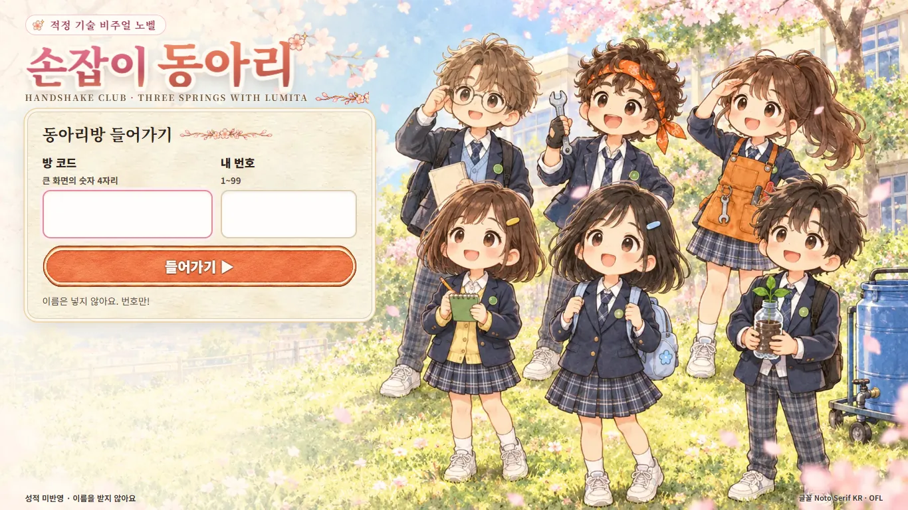
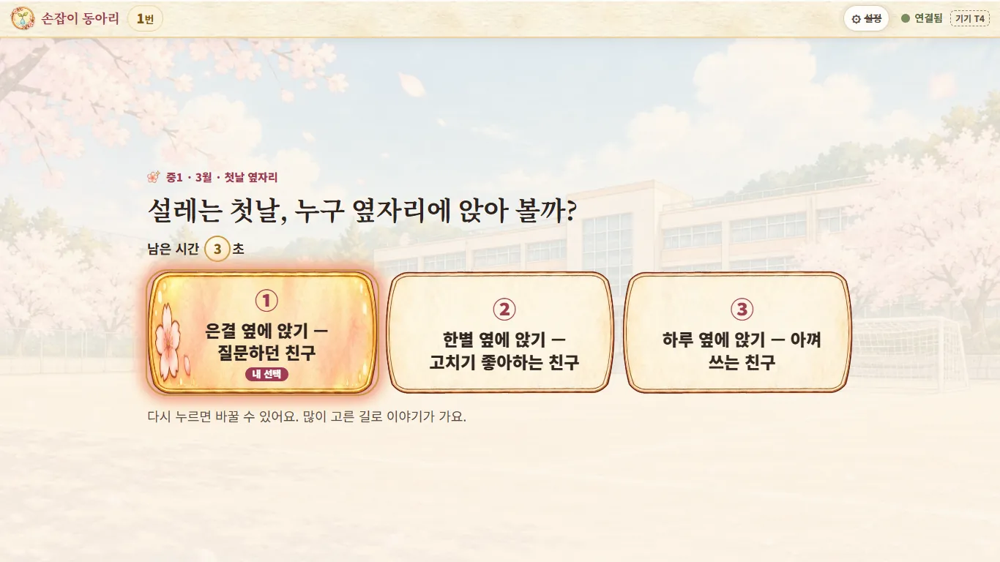
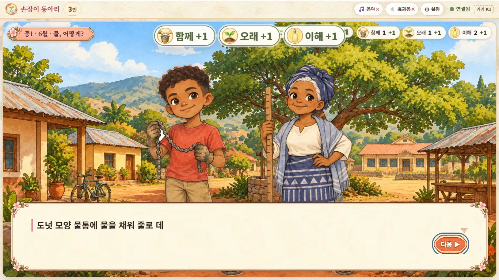
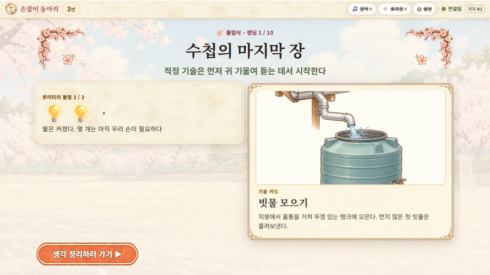
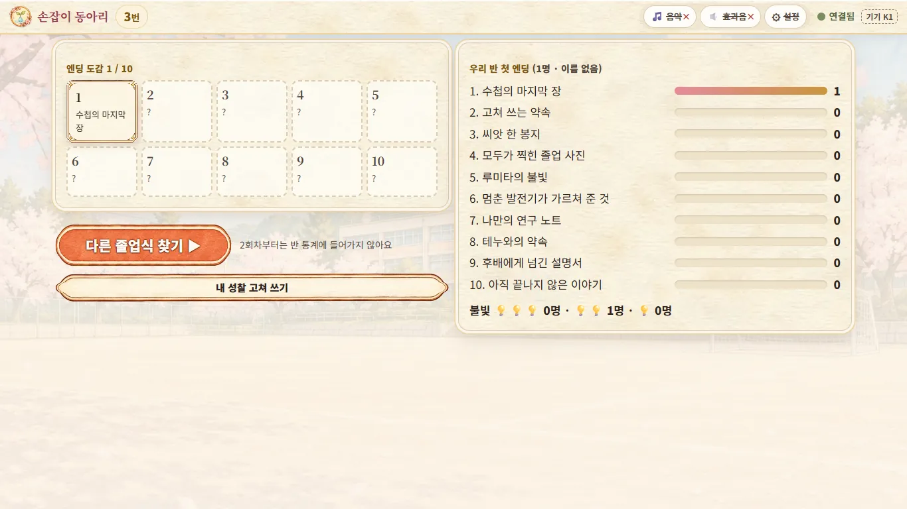
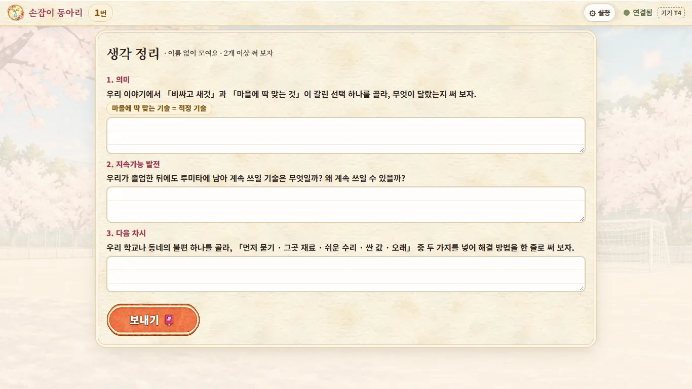

# 「손잡이 동아리」 학생용 사용법

> 크롬북으로 하는 적정 기술 이야기 게임이에요. 성적에는 들어가지 않아요.
> 학생 주소: **https://ict-handshake-club.netlify.app**

## 차례

1. [이 게임은 뭐예요?](#1-이-게임은-뭐예요)
2. [들어가기](#2-들어가기)
3. [화면 맨 위 띠 읽기](#3-화면-맨-위-띠-읽기)
4. [전체 모드 — 반 전체가 함께 골라요](#4-전체-모드--반-전체가-함께-골라요)
5. [개인 모드 — 내가 끝까지 해요](#5-개인-모드--내가-끝까지-해요)
6. [⚙ 설정 — 움직임과 소리](#6--설정--움직임과-소리)
7. [생각 정리(성찰)](#7-생각-정리성찰)
8. [이럴 땐 이렇게 해요](#8-이럴-땐-이렇게-해요)
9. [내 정보는 어떻게 되나요?](#9-내-정보는-어떻게-되나요)

---

## 1. 이 게임은 뭐예요?

- 우리 학교 「손잡이 동아리」가 먼 나라 **루미타 마을**과 3년 동안 함께 일하는 이야기예요.
- 중1에는 **물**, 중2에는 **빛(전기)**, 중3에는 **음식** 문제를 마을 사람들과 같이 풀어요.
- 마지막 장면은 언제나 **졸업식**이에요. 어떤 졸업식을 맞을지는 내가(우리 반이) 고른 길에 따라 달라져요.
- 갈림길은 모두 **12번**이에요. 처음에 주인공을 고르고, 이야기 속에서 11번 더 골라요.
- 졸업식 엔딩은 **10가지**예요.
- 이 게임으로 배우는 것: **적정 기술** — 그 마을 사람들이 쉽게 만들고, 쓰고, 고칠 수 있는 기술이에요.

> 루미타 마을과 「카렌도」라는 나라는 지어낸 이름이에요. 실제 나라가 아니에요.

## 2. 들어가기

1. 크롬북에서 **https://ict-handshake-club.netlify.app** 를 열어요.
2. **방 코드**에 큰 화면에 나온 **숫자 4자리**를 써요.
3. **내 번호**에 내 번호를 써요.
4. **들어가기 ▶** 를 눌러요.

- **이름은 쓰지 않아요.** 이름을 묻는 칸은 어디에도 없어요. 번호만 써요.
- 들어가면 「연결됨 ✅」과 내 번호가 크게 보여요. 그다음은 선생님이 시작할 때까지 기다려요.
- 창을 닫았다가 다시 열어도 괜찮아요. 6시간 안이면 아까 들어간 방에 **저절로 다시 들어가요**.

## 3. 화면 맨 위 띠 읽기

| 보이는 것 | 뜻 |
|---|---|
| **○번** | 지금 들어간 내 번호예요. 내 번호가 맞는지 꼭 확인해요 |
| 🎵 음악 · 🔊 효과음 | 소리를 켜고 끄는 단추예요(**개인 모드에서만** 보여요). 꺼져 있으면 단추에 ✕ 가 붙어요 |
| ⚙ 설정 | 움직임과 소리를 고치는 곳이에요. [6절](#6--설정--움직임과-소리)을 보세요 |
| ● 연결됨 | 인터넷에 잘 붙어 있어요 |
| ● 끊김 — 다시 연결 중 | 잠깐 끊겼어요. 대부분 저절로 다시 붙어요 |
| 기기 K7 같은 글자 | 이 크롬북의 표시예요. 같은 번호로 두 대가 들어오면 선생님이 이 글자로 구분해요 |

## 4. 전체 모드 — 반 전체가 함께 골라요

반 전체가 **한 사람의 3년**을 함께 골라요. 이야기는 **큰 화면**에 나오고, 크롬북은 **투표할 때만** 써요.

### 이야기가 나올 때

- 크롬북에는 「📺 큰 화면을 보세요」가 떠요.
- 큰 화면의 글은 **각자 눈으로** 읽어요. 글은 한 줄씩 저절로 넘어가요.
- 전체 모드 크롬북에서는 **소리가 나지 않아요.** 소리는 큰 화면에서만 나요. 30대가 한꺼번에 울리지 않게 하려는 거예요.

### 갈림길이 오면

1. 큰 화면에 **「갈림길!」** 이 떠요.
2. **💬 생각 시간 40초** — 질문과 선택지를 보고 옆 친구와 이야기해요. 크롬북의 단추는 아직 눌리지 않아요.
3. **투표 20초** — 크롬북 단추가 열려요. 마음에 드는 길을 눌러요.
   - 주인공 고르기와 마지막 갈림길(편지)은 **30초**예요.
   - 주인공 고르기는 생각 시간 없이 바로 투표해요.

- 누른 단추에 **「내 선택」** 이 붙어요.
- 마음이 바뀌면 **다른 단추를 다시 누르면 돼요.** 마지막에 누른 것만 세요.
- 「남은 시간 ○초」를 보고 시간 안에 내요. 모두 냈으면 **3초 뒤에 바로 마감**돼요.
- 시간이 지난 뒤에 누르면 「투표가 끝났어요」가 떠요.
- 큰 화면에는 「○ / ○명 냈어요」만 나와요. **누가 무엇을 골랐는지는 아무도 몰라요.**

### 결과는 이렇게 정해져요

- **가장 많이 고른 길**로 이야기가 가요. 반이 넘지 않아도 1등이면 돼요. 투표하지 않은 사람은 세지 않아요.
- 크롬북에 결과가 떠요.
  - 「우리 반은 ① ○○○」
  - 「내 선택: ① — 같은 길! ✨」 또는 「내 선택: ② — 다른 길도 좋은 생각이에요」
- **1등이 둘 이상이면(동률)** 「동률! 다시 투표」가 떠요. 1등이었던 길만 남기고 **15초 동안 다시** 투표해요.
- 다시 해도 동률이면 큰 화면에서 **🎲 이야기 주사위**가 굴러가 정해요.
- 아무도 내지 않았을 때도 🎲 주사위가 정해요.
- **빨리 누른 사람이 이기는 게 아니에요.** 빠르기는 결과와 상관없어요. 천천히 생각하고 골라도 돼요.
- 시간이 모자라면 선생님이 직접 고를 수도 있어요. 그때는 「선생님이 정했어요」가 떠요.

### 주인공은 어떻게 정해요?

- 「남학생(기본 이름 한결)」 · 「여학생(기본 이름 다온)」 · 「랜덤(주사위로 정하기)」 중에서 투표해요.
- 「랜덤」이 이기면 🎲 주사위가 남학생 · 여학생을 정해요.

### 끝나면

- 큰 화면에 졸업식 엔딩이 나오고, 크롬북에는 엔딩 이름과 **루미타의 불빛**(💡 1~3개)이 떠요.
- 선생님이 「생각 정리」를 열면 크롬북에 질문 칸이 나와요. [7절](#7-생각-정리성찰)을 보세요.

## 5. 개인 모드 — 내가 끝까지 해요

이야기 전체를 **내 크롬북에서 혼자** 끝까지 해요. 내 속도로 읽고, 갈림길도 내가 골라요.

### 시작하기

1. 선생님이 시작을 누를 때까지 「선생님이 시작하면 열려요」 화면에서 기다려요.
2. **주인공을 골라요** — 남학생 · 여학생 · 🎲 랜덤.
3. **이름을 골라요** — 보기 4개 중에서 하나를 골라요. 첫 번째 이름에 「기본」이 붙어 있어요. 성별을 바꾸고 싶으면 「← 성별 다시 고르기」를 눌러요.
   - 「랜덤」을 고르면 성별과 이름이 둘 다 저절로 정해져요.
   - 고른 성별과 이름은 **이 크롬북 안에만** 있어요. 선생님 화면에도 나오지 않아요.

### 글 넘기기

- **화면 아무 데나 누르거나**, 오른쪽 아래 **다음 ▶**, 또는 **스페이스 · Enter · →** 키로 넘겨요.
- 글자가 하나씩 찍히는 중이면, 첫 번째 누름은 글을 **한 번에 다 보여 주고**, 다음 누름에 넘어가요.
- 아주 빨리 두 번 눌러도 한 줄만 넘어가요. 놓치는 글이 없게요.
- 학년이나 계절이 바뀌면 「중2 · 겨울」 같은 **장 제목 카드**가 잠깐 떠요. 누르면 바로 닫혀요.
- 장면 마지막 줄에서는 단추가 **계속 ▶** 으로 바뀌어요.

### 갈림길에서 고르기

- 질문 아래 **단추 2~4개** 중에서 하나를 눌러요.
- **한 번 누르면 그 길로 바로 가요.** 되돌릴 수 없으니 잘 읽고 골라요.
- 갈림길 화면에서는 배경을 눌러도 넘어가지 않아요. 꼭 단추를 눌러야 해요.

### 지표 🤝 · 🌱 · 💡 와 ⚠

화면 오른쪽 위에 지표 3개가 있어요. 모두 0에서 시작해요.

| 지표 | 뜻 | 오르는 때 |
|---|---|---|
| 🤝 **함께** | 마을 사람과 같이 했나요? | 마을에 먼저 묻고, 같이 정하고, 같이 만들 때 |
| 🌱 **오래** | 마을이 계속 쓸 수 있나요? | 마을 재료를 쓰고, 싸고, 마을에서 고칠 수 있을 때 |
| 💡 **이해** | 기술의 원리를 아나요? | 어떻게 움직이는지 알아볼 때 |

- 고른 뒤에 「함께 +1」처럼 오른 만큼 잠깐 떠요.
- 친구나 마을 사람과 가까워지면 그 사람 옆에 **♪** 가 떠요. 친한 정도는 숫자로 보이지 않아요.
- **⚠ 헛걸음**은 화면에 보이지 않아요. 너무 비싸거나, 마을에 묻지 않았거나, 마을에서 고칠 수 없는 길을 고르면 몰래 쌓여요. 엔딩 카드의 **「다음엔 이렇게 해 볼까?」** 에서 알 수 있어요.

### 졸업식 엔딩

1. 마지막 편지를 고르면 졸업식 장면이 나와요.
2. 다 읽으면 **졸업식 카드 ▶** 를 눌러요.
3. **엔딩 카드**가 나와요.
   - 「졸업식 · 엔딩 ○ / 10」과 엔딩 이름, 그 엔딩이 알려 주는 한 줄
   - **루미타의 불빛** 💡 1~3개 — 내가 마을과 함께 한 프로젝트가 얼마나 잘됐는지 보여 줘요

     | 불빛 | 뜻 |
     |---|---|
     | 💡💡💡 | 마을이 스스로 불을 켜고, 고치고, 이어 간다 |
     | 💡💡 | 불은 켜졌다. 몇 개는 아직 우리 손이 필요하다 |
     | 💡 | 다음엔 처음부터 같이 정하자 |

   - **다음엔 이렇게 해 볼까?** — ⚠ 헛걸음이 된 선택과 그 까닭(있을 때만)
   - **기술 카드** — 이 엔딩과 이어지는 적정 기술 하나(그림 + 설명)
4. **생각 정리하러 가기 ▶** 를 눌러 질문에 답해요. 처음 졸업했을 때만 이 단계가 있어요.

> 연애 엔딩도, 우정 엔딩도, 혼자 연구하는 엔딩도 모두 같은 무게의 졸업식이에요. 어느 엔딩이 「정답」인 건 아니에요.

### 엔딩 도감과 반 통계

- **엔딩 도감 ○ / 10** — 내가 찾은 엔딩이 열려요. 아직 못 찾은 칸은 「?」예요.
  - 같은 엔딩을 남학생 · 여학생으로 모두 보면 그 칸에 「그림 2」가 붙어요.
- **우리 반 첫 엔딩** — 반 친구들이 맨 처음 본 엔딩이 몇 명인지 막대로 보여요. 이름은 없어요.
- **다른 졸업식 찾기 ▶** — 처음부터 다시 해요(2회차).
  - 이미 읽은 장면에는 **⏩ 읽은 장면 넘기기** 단추가 생겨요.
  - **2회차부터는 반 통계에 들어가지 않아요.** 반 통계에는 처음 본 엔딩만 들어가요.
- **내 성찰 고쳐 쓰기** — 보낸 생각 정리를 다시 고칠 수 있어요.

### 개인 모드에서 알아 둘 것

- 크롬북을 **새로 고쳐도** 하던 자리에서 이어서 해요. 진행 상황이 이 크롬북에 저장돼요.
- **다른 크롬북으로 바꾸면 처음부터** 해야 해요.
- 선생님이 **「모두 졸업!」** 을 누르면
  - 이미 졸업한 사람은 도감과 반 통계 화면이 그대로 보이고, 「선생님 화면을 보세요 — 반 통계를 함께 봐요」가 떠요.
  - 아직 졸업하지 못한 사람은 「선생님 화면을 보세요」가 떠요. 큰 화면을 같이 봐요.
- 소리는 **처음에 꺼져 있어요.** 듣고 싶으면 위쪽 🎵(음악) · 🔊(효과음)를 눌러요. **이어폰**을 쓰면 좋아요.

## 6. ⚙ 설정 — 움직임과 소리

화면 맨 위 띠의 **⚙ 설정**을 누르면 띠 바로 아래에 한 줄이 열려요. 닫을 때는 **닫기 ✕** 또는 **Esc** 키를 눌러요.

| 설정 | 고를 수 있는 것 | 언제 보여요? |
|---|---|---|
| ✨ **움직임** | **상 · 중 · 하 · 끄기** | 두 모드 모두 |
| 🎵 **배경음악** | 켬/끔 · 곡 1 「봄 교정」 · 2 「루미타 바람」 · 3 「동아리방 오후」 · 크기 | 개인 모드만 |
| 🔊 **효과음** | 켬/끔 · 크기(날씨 소리도 함께 켜지고 꺼져요) | 개인 모드만 |

- 크롬북은 처음에 움직임이 **「하」** 예요.
- 화면이 느리거나 끊기면 **「하」나 「끄기」** 로 바꿔요.
- 움직이는 화면을 보면 어지러운 사람도 **「끄기」** 로 바꾸면 돼요. 날씨 알갱이 · 흔들림 · 글자 찍기 · 꽃가루가 모두 꺼져요.
- 바꾼 설정은 이 크롬북에 기억돼요.
- 전체 모드에서는 ⚙ 안에 「이 화면은 소리가 나지 않아요 — 소리는 큰 화면에서」라고 나와요. 움직임만 바꿀 수 있어요.

| 움직임 | 화면 |
|---|---|
| 상 | 날씨 알갱이 · 숨쉬기 · 카메라 움직임 · 장 제목 · 글 효과가 모두 나와요 |
| 중 | 알갱이가 절반이에요. 흔들림 · 카메라 움직임은 없어요 |
| 하 | 나타나기 · 밀려오기만 있어요. 알갱이 · 숨쉬기는 없어요 |
| 끄기 | 움직임이 없어요. 화면이 바로 바뀌어요 |

## 7. 생각 정리(성찰)

- 전체 모드는 **선생님이 「생각 정리」를 열 때**, 개인 모드는 **처음 졸업한 뒤** 나와요.
- 질문은 3개예요. **2개 이상** 써 보세요. **적어도 1칸은 써야** 보낼 수 있어요.

| 번호 | 질문 |
|---|---|
| 1. 의미 | 우리 이야기에서 「비싸고 새것」과 「마을에 딱 맞는 것」이 갈린 선택 하나를 골라, 무엇이 달랐는지 써 보자. (마을에 딱 맞는 기술 = **적정 기술**) |
| 2. 지속가능 발전 | 우리가 졸업한 뒤에도 루미타에 남아 계속 쓰일 기술은 무엇일까? 왜 계속 쓰일 수 있을까? |
| 3. 다음 차시 | 우리 학교나 동네의 불편 하나를 골라, 「먼저 묻기 · 그곳 재료 · 쉬운 수리 · 싼 값 · 오래」 중 두 가지를 넣어 해결 방법을 한 줄로 써 보자. |

- 한 칸에 **200자**까지 쓸 수 있어요.
- 다 썼으면 **보내기 📮** 를 눌러요. 「성찰을 보냈어요」가 뜨면 끝이에요.
- 고치고 싶으면 **고쳐 쓰기**를 눌러 다시 보내요.
- 쓴 글은 **이름 없이** 큰 화면에 모여요. 순서도 섞여서 누가 썼는지 알 수 없어요.
- 수업에 맞지 않는 글은 선생님이 가릴 수 있어요. 가리면 그 글은 저장된 곳에서도 지워져요.
- 수업이 끝나면 모두 지워져요.

## 8. 이럴 땐 이렇게 해요

| 이런 글이 보이면 | 이렇게 해요 |
|---|---|
| 「방 코드는 숫자 4자리예요」 | 방 코드를 숫자 4개로 다시 써요 |
| 「그런 방이 없어요. 큰 화면의 방 코드를 다시 보세요」 | 큰 화면의 숫자를 다시 보고 써요 |
| 「우리 반 번호는 1~○번이에요. 번호를 다시 보세요」 | 우리 반 학생 수보다 큰 번호를 썼어요. 내 번호를 다시 확인해요 |
| 「번호는 1~99 사이예요」 | 번호를 1~99 사이로 써요 |
| 「연결이 안 돼요. 와이파이를 확인하고 다시 눌러 주세요」 | 와이파이가 켜져 있는지 보고 **들어가기**를 다시 눌러요 |
| 위 띠에 「끊김 — 다시 연결 중」 | 잠깐 기다려요. 대부분 저절로 다시 붙어요. 오래 가면 새로 고침(F5 · ⟳)을 눌러요. 6시간 안이면 같은 방 · 같은 번호로 다시 들어가요 |
| 「보내지 못했어요. 다시 눌러 주세요」 | 투표나 성찰이 안 갔어요. 같은 단추를 한 번 더 눌러요 |
| 「투표가 끝났어요」 | 시간이 지났어요. 다음 갈림길에서 내요 |
| 📵 「다른 기기에서 ○번으로 들어왔어요」 | 다른 크롬북이 **같은 번호**로 들어왔어요. 내 번호가 맞으면 **○번으로 다시 들어가기**, 틀렸으면 **번호 고치기**를 눌러요. 혹시 친구가 번호를 잘못 썼을 수 있으니 선생님께 말해요 |
| 「방이 닫혔어요. 선생님께 말해 주세요」 | 들어가려는 방이 이미 닫혔어요. 선생님께 새 방 코드를 물어봐요 |
| 👋 「수업이 끝났어요. 수고했어요!」 | 선생님이 수업을 끝냈어요. 창을 닫아도 돼요 |
| 개인 모드인데 소리가 안 나요 | 위 띠 🎵 · 🔊 에 ✕ 가 있으면 눌러서 켜요. 크롬북 소리 크기와 이어폰도 확인해요 |
| 전체 모드인데 소리가 안 나요 | 정상이에요. 소리는 큰 화면에서만 나요 |
| 화면이 느리거나 끊겨요 | ⚙ 설정에서 움직임을 **「하」나 「끄기」** 로 바꿔요 |
| 개인 모드 진행이 처음으로 돌아갔어요 | 다른 크롬북이나 다른 방으로 들어갔을 수 있어요. 진행은 그 방 · 그 크롬북에만 저장돼요 |

## 9. 내 정보는 어떻게 되나요?

- **이름은 아무 데도 쓰지 않아요.** 방 코드와 번호만 써요.
- 게임 속 주인공의 성별과 이름은 **내 크롬북 안에만** 있어요. 인터넷으로 보내지 않아요. 선생님도 몰라요.
- 인터넷으로 가는 것은 이것뿐이에요.
  - 내 번호와 접속했는지
  - 전체 모드: 고른 단추 번호
  - 개인 모드: 몇 번째 갈림길까지 갔는지, 고른 번호, 엔딩 번호, 불빛 수 — **모두 숫자**예요
  - 생각 정리에 쓴 글(이름 없이)
- 선생님이 **「수업 끝」** 을 누르면 이 기록이 **모두 지워져요.**
- 성적에는 들어가지 않아요. 편하게 골라 보세요.
